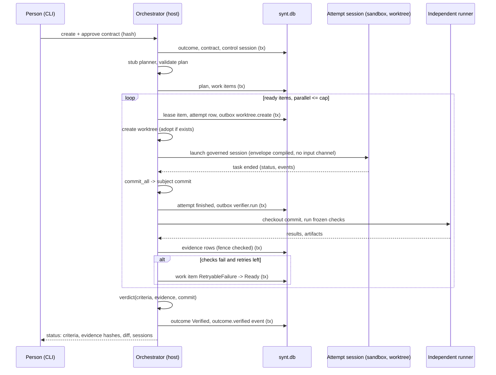
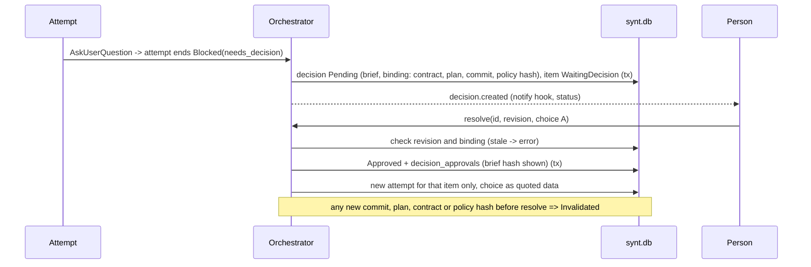

# Outcome orchestration: vertical-slice MVP

Status: Proposed (2026-11-14). Implementation starts only after the owner accepts ADR-016..021 (plan section 7). This slice is the design's section 31 scenario, adapted to this repo. It builds on, and does not repeat, the [ADRs](./adr/README.md), the [plan](./outcome-orchestration-plan.md) (PR order) and the [acceptance tests](../testing/outcome-orchestration-acceptance.md) (test specs).

Scenario goal: "Implement a small endpoint with tests, without changing the public contract or deployment configuration."

## 1. Vocabulary used below

Outcome, contract, plan, **work item** (the design's task), attempt, control session, decision, evidence: see ADR-017. A "task" is still one prompt-run inside a session.

## 2. Scenario steps mapped to the repo

Work item kinds in MVP: `agent` (runs an attempt = a governed session in a worktree) and `verify` (host-side independent runner, no model, no session).

| Step | What happens | Crates and types | Tables written | Events (additive, `v` = 1) | Surface |
|---|---|---|---|---|---|
| 1 | Person creates a contract with criteria and an envelope (read, write `src/**` and `tests/**`, tests, no network, no secrets, no push, no deploy) and approves it | `synthesis_core::outcome::{Contract, Envelope, validate_envelope}`; `synthesis_orchestrator::contract` | `outcomes`, `contracts`, control row in `sessions(kind='outcome')` | `outcome.created`, `outcome.contract_approved {version, hash}` | `synt outcome create --goal ... --criteria-file ... --envelope-file ...`, `synt outcome approve ID --version 1 --hash H` |
| 2 | Stub planner emits `inspect (agent, read-only) -> implement (agent, write) -> test (verify)` and the coverage map; validator checks it | `synthesis_core::outcome::{Plan, validate_plan}`; `synthesis_orchestrator::planner::StubPlanner` | `plans`, `work_items`, `work_item_deps` | `plan.created {version, items}` | `synt outcome plan ID` (print) |
| 3 | Scheduler leases ready items; allocator creates a session id and a worktree for each attempt; launch profile applies the envelope | `synthesis_orchestrator::{sched, attempt::AttemptRunner}`, `synthesis_workspace::WorktreeManager::create`, `synthesis_app::run::prepare` with the unattended profile | `attempts`, `outbox` (`worktree.create`), child `sessions` row | `work_item.state_changed`, `attempt.started {session_id, backend, guarantee}` | `synt outcome start ID`; `synt outcome status ID` |
| 4 | Worker edits scoped files; at attempt end the host commits the tree; the independent runner checks out the commit and runs the frozen checks | `WorktreeManager::commit_all`, `synthesis_verification::{evidence, runner}`; outbox `verifier.run` | `attempts.subject_commit`, `evidence` (class `independent_check`), `artifacts` | `attempt.finished {task_status, commit}`, `evidence.recorded {check, result, sha256}` | status shows criteria table |
| 5 | A planted failing test makes the check fail; the work item retries as a **new attempt** whose prompt carries the failure fingerprint and evidence summary (not the old history); second attempt passes | `sched` retry budget, `synthesis_core::outcome::WorkItemState::RetryableFailure` | `attempts` ordinal 2, `work_items.retries_used` | `work_item.state_changed`, new `attempt.started` | status shows attempt 1 failed, 2 passed |
| 6 | The model tries to write `infra/prod/deploy.yaml`; the compiled deny rule refuses it; the denial is audited; policy hash unchanged | `OrchGateway`, envelope compile into `synthesis_permissions` rules, sandbox `deny_paths` | none beyond events | `policy.decision {action, resource, result: deny, reason, policy_hash}` | `synt outcome inspect ATTEMPT --policy` |
| 7 | Progress and verification state show with zero routine approvals | `synthesis_view` outcome model (PR-11), CLI printer | none | none | `synt outcome status` (text and `--json`) |
| 8 | An ambiguous API change: the worker calls `AskUserQuestion`; the attempt ends `Blocked(needs_decision)`; the orchestrator builds a Decision with two alternatives | `synthesis_orchestrator::decision::build_brief`, ADR-019 section 2 | `decisions` (revision 1, binding fields) | `decision.created {id, kind, binding_hash}` | `synt outcome decisions ID` |
| 9 | The person picks alternative A with `decision.resolve`; the binding is re-checked; only the blocked work item re-runs, with the choice injected as a quoted data block; downstream items untouched | `decision::resolve`, `grants` (none needed here: a design choice, not a permission), `sched` | `decisions` (state Approved, revision 2), `approvals`-style row in `decision_approvals`, new `attempts` row | `decision.resolved {id, revision, choice}` | `synt outcome resolve DEC --revision 1 --choice A` |
| 10 | Verdict: every mandatory criterion has `independent_check` evidence for the current commit; outcome `Verified`; branch and patch available; attempt sessions inspectable | `synthesis_verification::verdict`, `WorktreeManager::diff` | `outcomes.state = Verified` | `outcome.verified {commit, evidence_ids}` | `synt outcome status`, `synt outcome inspect ATTEMPT` (links `synt sessions show`) |
| 11 | Kill the process at any step and restart; recovery marks lost attempts, replays or reconciles the outbox, expires nothing silently | `synthesis_orchestrator::recover` (extends `synthesis_session::recover`) | updates only | `outcome.recovered {report}` | `synt outcome resume ID` (also automatic on start) |

Step 9 simplification: a Decision that changes the contract or the plan makes a new contract or plan **version** and needs re-approval (ADR-019); the MVP supports the "choice injected into one item" path only and rejects a Decision that would need a replan with a clear error. The model replanner is deferred.

## 3. Minimal schema (migration v5, DDL sketch)

Additive only; shown in SQLite dialect like `synthesis-session/src/schema.rs`. Ids are UUIDv4 TEXT, times RFC 3339 UTC TEXT, JSON columns carry `CHECK(json_valid(...))`.

```sql
ALTER TABLE sessions ADD COLUMN kind TEXT NOT NULL DEFAULT 'chat';       -- 'chat' | 'outcome'

CREATE TABLE outcomes(
  id TEXT PRIMARY KEY,
  workspace_id TEXT NOT NULL, repo_root TEXT NOT NULL, base_commit TEXT NOT NULL,
  control_session_id TEXT NOT NULL UNIQUE REFERENCES sessions(id),
  goal TEXT NOT NULL, state TEXT NOT NULL, revision INTEGER NOT NULL,
  contract_version INTEGER NOT NULL, plan_version INTEGER,
  created_at TEXT NOT NULL, updated_at TEXT NOT NULL);

CREATE TABLE contracts(
  outcome_id TEXT NOT NULL REFERENCES outcomes(id), version INTEGER NOT NULL,
  hash TEXT NOT NULL, body TEXT NOT NULL CHECK(json_valid(body)),       -- goal, criteria, envelope
  approved_by TEXT, approved_at TEXT,
  PRIMARY KEY(outcome_id, version));

CREATE TABLE plans(
  outcome_id TEXT NOT NULL REFERENCES outcomes(id), version INTEGER NOT NULL,
  contract_version INTEGER NOT NULL, hash TEXT NOT NULL,
  dag TEXT NOT NULL CHECK(json_valid(dag)),
  PRIMARY KEY(outcome_id, version));

CREATE TABLE work_items(
  id TEXT PRIMARY KEY, outcome_id TEXT NOT NULL REFERENCES outcomes(id),
  plan_version INTEGER NOT NULL, key TEXT NOT NULL, kind TEXT NOT NULL,   -- 'agent' | 'verify'
  spec TEXT NOT NULL CHECK(json_valid(spec)),
  state TEXT NOT NULL, revision INTEGER NOT NULL, retries_used INTEGER NOT NULL DEFAULT 0,
  UNIQUE(outcome_id, plan_version, key));
CREATE TABLE work_item_deps(
  work_item_id TEXT NOT NULL REFERENCES work_items(id),
  requires_id  TEXT NOT NULL REFERENCES work_items(id),
  PRIMARY KEY(work_item_id, requires_id));

CREATE TABLE attempts(
  id TEXT PRIMARY KEY, work_item_id TEXT NOT NULL REFERENCES work_items(id),
  ordinal INTEGER NOT NULL, session_id TEXT NOT NULL UNIQUE REFERENCES sessions(id),
  worker_kind TEXT NOT NULL,                                              -- 'local-inproc' | 'local-engine'
  state TEXT NOT NULL, revision INTEGER NOT NULL, fence INTEGER NOT NULL,
  task_status TEXT, subject_commit TEXT, retained_reason TEXT,
  started_at TEXT NOT NULL, ended_at TEXT,
  UNIQUE(work_item_id, ordinal));

CREATE TABLE evidence(
  id TEXT PRIMARY KEY, outcome_id TEXT NOT NULL REFERENCES outcomes(id),
  work_item_id TEXT NOT NULL REFERENCES work_items(id), attempt_id TEXT REFERENCES attempts(id),
  trust_class TEXT NOT NULL, producer TEXT NOT NULL,
  subject_commit TEXT NOT NULL, check_id TEXT NOT NULL, command_hash TEXT,
  criteria_ids TEXT NOT NULL CHECK(json_valid(criteria_ids)),
  result TEXT NOT NULL, exit_code INTEGER, env_fingerprint TEXT NOT NULL,
  artifact_session_id TEXT, artifact_id TEXT, sha256 TEXT, flags TEXT NOT NULL DEFAULT '[]',
  fence INTEGER NOT NULL, captured_at TEXT NOT NULL,
  UNIQUE(attempt_id, check_id, subject_commit));

CREATE TABLE decisions(
  id TEXT PRIMARY KEY, outcome_id TEXT NOT NULL REFERENCES outcomes(id),
  kind TEXT NOT NULL, dedupe_key TEXT NOT NULL,
  state TEXT NOT NULL, revision INTEGER NOT NULL,
  brief TEXT NOT NULL CHECK(json_valid(brief)),
  binding TEXT NOT NULL CHECK(json_valid(binding)),                       -- contract/plan versions, commit, policy hash, action hash
  expires_at TEXT NOT NULL, created_at TEXT NOT NULL,
  UNIQUE(outcome_id, dedupe_key));
CREATE TABLE decision_approvals(
  id TEXT PRIMARY KEY, decision_id TEXT NOT NULL REFERENCES decisions(id),
  decision_revision INTEGER NOT NULL, approver TEXT NOT NULL,
  choice TEXT NOT NULL, brief_sha256 TEXT NOT NULL,                       -- what the person was shown
  decided_at TEXT NOT NULL);
CREATE TABLE grants(                                                       -- created only with permission decisions (not in the MVP scenario)
  id TEXT PRIMARY KEY, decision_id TEXT NOT NULL REFERENCES decisions(id),
  action_hash TEXT NOT NULL, expires_at TEXT NOT NULL, consumed_at TEXT);

CREATE TABLE outbox(
  id TEXT PRIMARY KEY, outcome_id TEXT NOT NULL REFERENCES outcomes(id),
  idempotency_key TEXT NOT NULL UNIQUE, kind TEXT NOT NULL,               -- 'worktree.create' | 'worktree.cleanup' | 'verifier.run'
  payload TEXT NOT NULL CHECK(json_valid(payload)),
  state TEXT NOT NULL, tries INTEGER NOT NULL DEFAULT 0, next_at TEXT, receipt TEXT);
CREATE INDEX outbox_pending ON outbox(state, next_at);
CREATE INDEX work_items_state ON work_items(outcome_id, state);
```

Not in v5 (added by the feature that needs them): `inbox`, `resource_locks`, `policy_versions` (the MVP records the policy hash inside events and bindings), `attention_events`. The `grants` table may be left out of the first migration if no MVP step uses it; including it now avoids a v6 for PR-10 (decision for the implementer, not blocking).

Transition API (pure SQL in `synthesis-session::outcome`): `transition(table, id, expected_revision, to_state, events, outbox) -> Result<NewRevision, Conflict>` executed in one IMMEDIATE transaction through the existing append path (ADR-016 item 3). Existing tables are untouched apart from `sessions.kind`.

## 4. Sequence: happy path with one retry



## 5. Sequence: decision



## 6. Sequence: crash and recovery

```mermaid
sequenceDiagram
  participant O as Orchestrator (restarted)
  participant S as synt.db
  participant L as Session locks
  participant FS as Worktrees
  O->>S: open (backup if migrating), load outcomes Running/Verifying/Blocked
  O->>L: try lock each Starting/Running attempt session
  alt lock held
    O->>O: attempt alive: re-attach or wait
  else lock free
    O->>S: session Interrupted, attempt Lost, item Recovering (tx)
  end
  O->>S: outbox pending: replay; dispatching: probe effect
  O->>FS: worktree exists? adopt / redo / cleanup refused (kept)
  O->>S: re-check policy hash, evidence freshness (stale marked)
  O->>S: outcome.recovered report
```

## 7. Cut from the MVP (and why)

- Merge, push, any external write (D8); the MVP stops at a branch and a patch.
- Model planner and replanner; plan diff and impact analysis (stub planner only; contract or plan change needs a new version and re-approval).
- Desktop UI and the single inspector (PR-12); the CLI and protocol v4 come first.
- Inbox, GitHub and external events (AC-14); remote workers; daemon.
- Resource locks beyond a single orchestrator (no integration step yet), watchdog, Inline+Spill context.
- Auto judge, MCP servers, browser in attempts.
- Native Windows execution (WSL only).
- Metrics export and attention analytics (events suffice).
- Dependent work items that need a predecessor's **code** (base-commit option is implemented in PR-04 but unused).

## 8. Definition of done

1. All of PR-S1, PR-01, PR-02, PR-04, PR-05, PR-06, PR-07, PR-08, PR-09, PR-10, PR-11 merged, behind `synt.outcomes.enabled` (default off), CI `ci-ok` green on macOS, Ubuntu, Windows.
2. The 11-step scenario runs as one e2e test (`apps/cli/tests/outcome_e2e.rs::mvp_scenario`) with the scripted model on macOS and Ubuntu, including a kill -9 at three points (step 11).
3. AC-01, AC-02, AC-03, AC-04, AC-05, AC-06, AC-07, AC-08, AC-09, AC-10 (data), AC-12, AC-13, AC-15 pass as specified in the acceptance document; AC-11 passes at view-model level; AC-14 is explicitly deferred.
4. Security rows T-01..T-14, T-16, T-17, T-24, T-27, T-28 pass; T-19, T-21 (Linux), T-23 are recorded as known gaps with the owner's acknowledgement.
5. Security review completed for PR-S1, PR-08, PR-09, PR-10 with findings fixed or accepted in writing.
6. `synt sessions verify` verifies the control session; a tampered outcome event is detected.
7. Migration v5 tested from a v4 database; the pre-migration backup exists; the release note states the downgrade rule.
8. `docs/STATUS.md`, `docs/SECURITY.md` (sandbox note for attempts) and `docs/UNATTENDED.md` (chain-key correction) updated by the PRs that change them; the ADRs set to Accepted and registered in the design doc, section 9.
9. Honest limits shown in the CLI output: sandbox backend and guarantee per attempt; "verified" means independent checks passed for the stated commit, not that the criterion is semantically proven.
