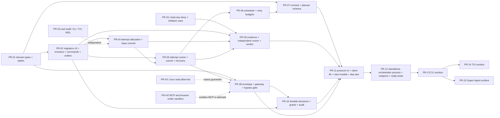

# Outcome orchestration: phased plan and PR slicing

Changelog: 2026-11-14 rev 2 (owner): the orchestrator serves CLI, TUI and Super Agent through one core and one protocol; standalone orchestrator process; durable decisions and commands; explicit v5 migration; delivery order core, protocol, CLI, TUI, Super Agent; D4, D5, D6 revised and D17-D21 added. Rev 1 (same day): first version.

Status: Proposed (2026-11-14, rev 2). Nothing here is scheduled until the owner answers the decisions in section 7.
Inputs: [gap analysis](./outcome-orchestration-gap-analysis.md), [ADRs](./adr/README.md). Test specs: [acceptance](../testing/outcome-orchestration-acceptance.md). Threat model: [threat model](./outcome-orchestration-threat-model.md). First slice: [MVP slice](./outcome-orchestration-mvp-slice.md).

Estimates are rough guesses for one engineer plus review (S <= 2 days, M 3-5, L 6-10), not measurements. The repository rule applies to every PR: `cargo fmt --all --check`, `cargo clippy --workspace --exclude synthesis-desktop --all-targets -- -D warnings`, `cargo test --workspace --exclude synthesis-desktop` (add `-p synthesis-desktop` for desktop PRs), `node scripts/check-no-legacy-name.mjs`, and the CI job set (`ci-ok`). Every PR that touches permissions, sandbox, secrets, input validation or the store goes through the read-only security reviewer before merge (owner rule, `HANDOFF.md` 7k). Work happens in worktrees under `.claude/worktrees/`.

## 1. Phases

Delivery order (owner, multi-surface rule 13): **core, protocol, CLI, TUI, Super Agent.** The CLI is the cheapest full lifecycle proof; the TUI and Super Agent are added as thin clients of the same protocol. Terminology: CLI = `synt` binary and terminal app; TUI = desktop terminal-style tab; Super Agent = desktop Agent tab (see the [gap analysis, section 9](./outcome-orchestration-gap-analysis.md)).

| Phase | Content | Exit gate |
|---|---|---|
| P0 Decisions | Owner answers section 7; ADRs move to Accepted; registry rows added | ADR-016..021 Accepted |
| P1 Core foundations | Domain types, migration v5 with revisions and commands, cwd audit, chain-key fix | Pure tests green on 3 OS; migration test from a v4 fixture; CAS and idempotency tests |
| P2 Core execution | Attempt allocation, runner, cancel, recovery, scheduler | AC-02, AC-03, AC-04, AC-13 at protocol level on macOS and Linux |
| P3 Core control | Contract, envelope, gateway, durable decisions, bypass gate | AC-05, AC-06, AC-09, AC-10 (data), policy adversarial suite, the ADR-019 section 6 gate |
| P4 Core evidence | Independent runner, verdict | AC-07, AC-08, forged-evidence red-team cases |
| P5 Protocol | Protocol v4, client library (InProc, Stdio), view models, dependency test; then the standalone orchestrator process (LocalSocket) | Whole lifecycle provable headless through the client (acceptance document, section 1) |
| P6 CLI | `synt outcome ...`, `outcome enable`, notify kinds | MVP definition of done |
| P7 TUI | Outcomes group, decision picker, inspector tabs | AC-11 rendering tests; multi-surface tests with the CLI as the second client |
| P8 Super Agent | Surface per the owner's design (specified in ADR-021; implementation blocked on the design) | Same protocol tests, plus its rendering tests |
| Parallel hardening | Linux read allow-list, MCP/browser under sandbox, rlimits | Gap analysis R-8 closed |
| Later | Inline+Spill context, watchdog, external events, remote workers | Separate designs |

## 2. Dependency graph

Critical path to the MVP (CLI): PR-01, PR-02, PR-04, PR-05, PR-06, PR-07, PR-08, PR-10, PR-11, PR-12, PR-13 (PR-09 in parallel after PR-05). The feature cannot be enabled in any surface before PR-08's bypass gate passes. PR-S1 and PR-03 can start immediately and need only the decisions on naming.

## 3. PR slices

Mapping to the design's list: design PR-01 -> PR-01, PR-02 -> PR-02, PR-03 -> PR-03 (plus audit scope), PR-04 -> PR-04, PR-05 -> PR-05, PR-06 -> PR-06, PR-07 -> PR-07, PR-08 -> PR-08, PR-09 -> PR-09, PR-10 -> PR-10, PR-11 -> PR-11 to PR-15 (protocol, orchestrator process, then one PR per surface), the design's PR-12..15 (Inline+Spill, watchdog, GitHub, remote) -> deferred (section 6). PR-S1 and PR-H* are new because the repo shows gaps the design does not know about.

### PR-S1 Chain key off the sandbox read path
- Scope: add `chain.key` to `synthesis_state_paths` (`synthesis-sandbox/src/lib.rs:480-497`); decide per path whether `sessions/`, `config.json`, `state.json` follow (test first); correct `docs/UNATTENDED.md:49`.
- Crates: `synthesis-sandbox`, tests in `synthesis-app/tests/state_files_protected.rs`, `tests/redteam`.
- Tests: red-team `evid-chain-key-read` (Linux bubblewrap must not read it; macOS must not read it); unit test that the path list contains it.
- Covers: ADR-020 anti-forgery, threat T-E3.
- Risk: Low; a sandboxed toolchain that wants the home dir could break (state paths are exact names, `chain.key` is not a tool path). Rollback: revert one line.
- Size: S. Security review: yes.

### PR-01 Domain types and transition tables
- Scope: `synthesis-core::outcome`: ids (UUIDv4 strings), enums `OutcomeState`, `WorkItemState`, `AttemptState`, `DecisionState`, transition functions in the style of `session.rs:48-67`, contract/plan structs (serde), plan validator (unknown dependency, cycle, unknown capability, uncovered mandatory criterion), `Envelope` type and its compile-time refusals (no allow for irreversible actions).
- Crates: `synthesis-core`.
- Tests: table-driven transition tests (every pair), property-style cycle tests, serde round trips; runs on all OSes.
- Covers: AC-01 (validation half), AC-09 (state half).
- Risk: Low (pure). Rollback: revert. Size: M.

### PR-02 Migration v5, outcome store, outbox
- **Prerequisite for merging:** PR-S1 / PR #117 (chain key and `backups/` read deny, red-team cases `evid-chain-key-read`, `evid-backups-read`) is merged into main; this branch contains it. The store's MACs are only as good as the key's confinement.
- Scope: `schema.rs` v5 (DDL in the [MVP slice](./outcome-orchestration-mvp-slice.md) section 3), `sessions.kind`, `synthesis-session::outcome` (CAS transitions, **`outcome_commands` with idempotency keys and result write-back, optimistic revisions: Phase 1**, outbox, evidence insert API without runner), kind filters in listers and cleaners, `StoreOptions` migration target so a default open stays at v4 (`store.rs:585`) and v5 is applied only by the explicit `enable` step with the automatic pre-migration backup (`clean.rs:431` pattern).
- Crates: `synthesis-session`, `synthesis-events` (additive event types and payload structs).
- Tests: v4 -> v5 migration fixture; CAS conflict; outbox replay after a killed writer (reuse `synthesis-session/tests/crash.rs` helpers); chain verification over outcome events (`tests/governance.rs` style); control session hidden from `list_used_sessions` and `clean`; `SchemaTooNew` for a v4-target open on a v5 DB (assert error text); a default open leaves v4 at v4; command idempotency and stale-revision results.
- Covers: AC-04 (store half), HARD-4, HARD-8, HARD-9.
- Risk: Medium (migration, user data). Rollback: restore the pre-v5 backup; documented. Size: L.

### PR-03 cwd scoping audit and tests (independent)
- **Audit result (implemented):** the one real defect was the desktop `/new` fallback to the running engine's folder when the selected workspace was missing from the list (D7); it is now `new_session_root`, a refusal with a visible note. A store-level check was absent and is added: `create_session` refuses a context whose cwd is outside its root and added folders (`OutsideWorkspace`). Verified by test: desktop relaunch targets (`New`, `Model`, `Close`, `Resume` while another folder was active) in `apps/desktop/tests/commands_fake.rs`; the `/new` rule; engine `start` (relative, missing, file cwd refused; `session.new` keeps the folder; another folder's session never resumed) in `apps/cli/tests/engine_stdio.rs`; store containment and own-cwd in `synthesis-session/tests/store.rs`; `check_resumable` and `check_reported` (WSL) and the CLI `/new` test already existed. Verified by reading only: `launch_dir` (one `current_dir()` read, `--cwd` wins), the desktop `main.rs` start folder, `is_here` for `--continue`/`--resume`.
- Scope: tests and, only if a defect is found, fixes for the three entry points (CLI launch, desktop TUI, WSL; the Super Agent has none yet); store-level check that a session's `cwd` lies in `workspace_root` or an additional dir if absent (**unverified** whether it exists); desktop `Action::New` fallback becomes a refusal (decision D7).
- Crates: `apps/desktop`, `synthesis-cli-ui`, `synthesis-session`, `synthesis-app`.
- Tests: desktop `commands_fake.rs`-style test for every `Target` (`New`, `Resume`, `Model`, `Trust`, `Close`, `CloseWorkspace`), WSL `check_reported` cases, existing CLI test `synthesis-cli-ui/src/app/tests.rs:2958` kept, new store test for cwd containment.
- Covers: AC-03, HARD-3.
- Risk: Low-Medium (desktop behaviour change on D7). Rollback: revert. Size: M. Needs the desktop job (heavy); no new window tests.

### PR-04 Attempt allocation and base commit
- **Status (implemented):** `WorktreeManager::create_at`, `allocate_unstarted`, `head`; new crate `synthesis-orchestrator` (`Allocator`, `finish_attempt`, `cleanup_attempt`, `retention_due`); store additions `set_attempt_retained` and `Store::set_git_info_if_unset`. See ADR-018 implementation notes.
- Scope: orchestrator-side allocation (session id first, worktree, record `GitInfo`) with crash reconcile; `WorktreeManager` option to start at a given commit (only needed after MVP; implement the API, test it, do not use it in MVP); host `commit_all` at attempt end; `retained_reason` on refused cleanup.
- Crates: `synthesis-workspace`, `synthesis-orchestrator` (new, first code), `synthesis-session`.
- Tests: crash between worktree creation and DB commit (adopt/redo); two attempts get distinct dirs, branches and sessions (extends `workspace.rs:376`); cleanup refusal keeps the tree.
- Covers: AC-02 (isolation), HARD-3.
- Risk: Medium (git on three OSes, long paths on Windows). Rollback: revert; worktrees are plain git. Size: M.

### PR-05 Attempt runner, cancel and recovery
- **Status (implemented):** `Profile`, `Runner`, `recover_attempts`, `CancelFlag`, `SyntSpawn` in `synthesis-orchestrator`; `--attempt-session` in `synt run`; schema additions `attempts.worker_pid/worker_start/heartbeat_at`, `Store::resume_attempt_session`, fence checks (`record_worker`, `heartbeat`). See ADR-017 implementation notes. Not done here: envelope-to-rules compile and the OrchGateway (PR-08), the scheduler that decides when to run (PR-06), the independent verifier (PR-09), the standalone process (PR-12).
- Scope: start a governed session for an attempt through `run::prepare`/host with the unattended profile; map `TaskStatus` to attempt state; cancel via stop path and process-tree kill; orchestrator startup recovery (lost attempts, outbox replay) with a recovery report event.
- Crates: `synthesis-orchestrator`, `synthesis-app`.
- Tests: fake provider (`test-provider` feature) attempt end-to-end; kill -9 the orchestrator mid-attempt and recover (new e2e `outcome_recovery`); cancel kills a spawning tree within a bound (AC-13).
- Covers: AC-04, AC-13, AC-15, HARD-8.
- Risk: High (concurrency, process lifetime, Windows flake pattern at `docs/STATUS.md` SQLite lock). Rollback: feature flag `synt.orchestrator.enabled` default off. Size: L.

### PR-06 Scheduler and retry budgets
- Scope: bounded-parallel DAG walk, canonical ordering, retry budget per work item, blocked state with reason; no resource locks yet.
- Crates: `synthesis-orchestrator`.
- Tests: synthetic DAG with injected failures (design Phase 3 gate): no duplicate assignment, no cycle, retries bounded, 1,000 queued items do not spawn more than the cap (stub attempts).
- Covers: AC-02 (parallelism), AC-07.
- Risk: Medium. Rollback: flag. Size: M.

### PR-07 Contract and planner schema
- Scope: contract model (goal, criteria with optional check commands, envelope), approval records the contract hash (surface-independent; the CLI form comes in PR-13); deterministic stub planner (inspect -> implement -> test); planner JSON schema validation; model planner behind the same schema later.
- Crates: `synthesis-orchestrator`.
- Tests: schema rejections; approval hash stability; contract immutability.
- Covers: AC-01.
- Risk: Low-Medium. Size: M.

### PR-08 Envelope compiler, gateway, non-interactive attempts
- Scope: envelope -> rules/mode/sandbox/budget compile; `OrchGateway`; attempt launch profile (no bypass, no auto judge, no Always, no project trust, no MCP unless listed); `AskUserQuestion` and denials recorded as `needs_decision` (ADR-019 section 2).
- Crates: `synthesis-orchestrator`, `synthesis-permissions` (only if a hook is missing; prefer none), `synthesis-app`.
- Tests: golden compile tests; fuzz: no generated allow for any `irreversible.rs` action; red-team cases (threat model) in all four modes; AC-05, AC-06.
- Gate: includes the ADR-019 section 6 bypass-closure tests; until they pass, `synt.orchestrator.enabled` is refused by `outcome enable`.
- Risk: High (security). Rollback: flag. Size: L. Security review: mandatory, two rounds expected.

### PR-09 Evidence, independent runner, verdict
- Scope: `evidence` writes, host-side runner on a detached checkout, trust classes, pure `verdict`, stale marking, environment fingerprint.
- Crates: `synthesis-verification`, `synthesis-orchestrator`, `synthesis-session`.
- Tests: exhaustive verdict table; forged report file does not clear the gate; `definitions_changed` blocks; stale commit rejected; fence rejection; runner refuses without enforce.
- Covers: AC-08, forged-evidence cases.
- Risk: High (runs agent-written tests on the host under the sandbox). Rollback: flag. Size: L. Security review: mandatory.

### PR-10 Decisions, grants, audit
- Scope: durable decision lifecycle (rows, not live asks), single-answerer CAS and the race table of ADR-019 section 5, brief builder (structured, no recommended/selected field), dedupe, bindings, expiry timer, invalidation on contract/plan/commit/policy change, one-shot grant that starts a new attempt, `policy.decision` events.
- Crates: `synthesis-orchestrator`, `synthesis-session`.
- Tests: stale decision replay after a commit change is rejected; revoked grant; expiry moves to HOLD, never approve; dedupe; no default choice in the brief schema; AC-09, AC-10 (data shape).
- Risk: Medium-High. Size: L. Security review: yes.

### PR-11 Protocol v4, client library, view models
- Scope: `PROTOCOL = 4`; methods of ADR-021 section 1; `synthesis_app::outcome_client` with transports `InProc` (tests and headless CI only) and `Stdio` (WSL engine link); `synthesis-view::outcomes` models and the shared inspector tab set; **dependency test**: `apps/*`, `synthesis-cli-ui*`, `synthesis-view` must not depend on `synthesis-orchestrator`; renderer field-coverage helper for decision briefs.
- Crates: `synthesis-app`, `synthesis-view`, `synthesis-orchestrator`.
- Tests: protocol golden lines; the whole acceptance suite driven through the client (this is the headless lifecycle proof); hostile-engine cases (unsolicited resolve); reconnect with `after_event_id`; two clients racing `decision.resolve`.
- Covers: AC-01..AC-15 at protocol level, multi-surface rules 1, 2, 4, 5, 6, 14.
- Risk: Medium (lock-step version). Size: L.

### PR-12 Standalone orchestrator process
- Scope: hidden `synt orchestrator --serve` (detached, idle exit `synt.orchestrator.idle_exit_minutes`); `LocalSocket` transport (unix socket or named pipe under `$SYNT_HOME/run/`, peers' framing and HMAC handshake, key `run/orch.key`); control-session lock ownership and takeover; auto-start by clients and `outcome resume`; notify kinds `decision.created`, `outcome.blocked`, `outcome.verified` and the `needs_you` derivation; `orchestrator.enable` (explicit migration with backup and compatibility notice); add the endpoint and key to `synthesis_state_paths` (they live under the already-denied `run/`; test it).
- Crates: `synthesis-app`, `synthesis-orchestrator`, `synthesis-peers` (reuse `net.rs`, extract a shared module only if needed), `synthesis-sandbox` (test only), `apps/cli` (the hidden subcommand).
- Tests: kill the surface, outcome continues; kill the orchestrator, another client restarts it and recovery runs; two orchestrators race for one outcome (lock decides); sandboxed attempt cannot connect (red-team `orch-endpoint-from-attempt`); idle exit; notification fired with no client attached.
- Covers: multi-surface rules 3, 7; AC-04 (process level), threat T-32, T-36.
- Risk: High (process lifecycle on three OSes, Windows named pipes **unverified**; WSL reach unverified). Rollback: flag; fall back to L1 (in-process plus `outcome resume`) as a degraded mode. Size: L.

### PR-13 CLI surface (MVP)
- Scope: `synt outcome create|approve|start|status|list|decisions|resolve|pause|resume|cancel|inspect|enable` (text and `--json`), thin over the client library with the `LocalSocket` transport; picker without default for `resolve`; terminal app `/outcomes` (read and resolve) after the subcommands; `synt.cli.outcomes.*` rendering keys.
- Crates: `apps/cli`, `synthesis-cli-ui*`, `synthesis-view`.
- Tests: command dispatch and rendering only (output goldens for each brief field, no preselection, platform refusal text); behaviour is already proven by PR-11 tests.
- Covers: MVP definition of done; AC-10 (CLI rendering).
- Risk: Low-Medium. Size: M.

### PR-14 TUI surface
- Scope: Outcomes group in the Workspace panel, control-session chat, decision picker, inspector tab container in the right drawer region while an outcome is selected; `synt.tui.outcomes.*`; Settings toggle for `synt.orchestrator.enabled` that calls `orchestrator.enable`.
- Crates: `apps/desktop` (`tui_view/`), `synthesis-view`.
- Tests: `design_tests` bounds for new rows, snapshot of a decision card, no-preselection rule test, multi-surface test with the CLI as the second client (race on one decision).
- Covers: AC-10, AC-11 (rendering), HARD-11 (TUI).
- Risk: High (UI regression, desktop CI job, `design_tests`). Size: L (probably two PRs). Blocked on D5, D6.

### PR-15 Super Agent surface
- Scope: per the owner's Super Agent design (not yet available): outcome list and goal conversation, Decision/Task inbox, one right-side inspector with the shared tab set, decision cards from the structured brief; replaces the "Coming soon" page behind the flag. `synt.superagent.*` if the owner wants a section (D17).
- Crates: `apps/desktop`, `synthesis-view`.
- Tests: rendering and command dispatch only, plus the shared field-coverage helper.
- Risk: High (new design). Size: L. **Blocked** until the design exists; this PR is specified, not scheduled.

### PR-H1, H2, H3 Known hardening (already listed by the owner, `docs/specs/sandbox-hardening.md` sections 2-4)
- H1 Linux read allow-list; H2 MCP stdio and browser worker under the sandbox; H3 rlimits and disk quota. They are not prerequisites of the MVP but each one upgrades what the UI may claim (ADR-018 item 9) and closes risks R-8. H4 (Windows AppContainer) needs an ADR-010 exception (decision D3).

## 3b. Enable gate (before PR-13 turns the feature on for real attempts)

`synt outcome enable` must refuse, and no surface may offer the toggle, until every item holds:

1. **PR-S1 merged** and the red-team cases `evid-chain-key-read`, `evid-backups-read` and `orch-db-write-from-attempt` are enforced (green) on Linux and macOS CI.
2. **PR-08 bypass gate** passed (ADR-019 section 6).
3. **Native Windows refuses writable attempts** (D3); the refusal text is shown by every surface.
4. **Authority is consumed only from verified data.** PR-10 re-checks a decision's binding against the current state and ties each approval to its signed `decision.resolved` event; PR-09 computes the verdict only from signed `evidence.recorded` events (today a writer without the key can INSERT a passing `independent_check` row with plain SQL, and the MVP verdict in the store must not be relied on).
5. **Attempts run with no MCP servers and no project hooks by default** (T-23 `pol-mcp-not-in-attempt-by-default`). Highest priority.
6. **The integrity claim and the per-attempt sandbox guarantee are shown to the user at enable time.** The claim: "Outcome state is protected from agent attempts by the OS sandbox (platform dependent; native Windows refuses writable attempts). Approvals and events carry HMACs under a per-user key stored next to the data: they detect corruption, old binaries and writers that cannot read the key; they do not detect or prevent changes by any program running as the same user outside the sandbox, and they do not detect a cut-off tail of events."

Acceptance criteria for PR-09 and PR-10: **every read that grants authority verifies the control-session chain and that the row matches its signed event.** PR-12's standalone process is an ownership boundary, not a security boundary; separate-OS-user daemons and person-present signatures for irreversible decisions are post-MVP owner decisions.

## 4. Cross-platform requirements

- Pure logic (domain, validator, scheduler with stub attempts, verdict, brief builder, envelope compiler, store) must pass on macOS, Linux and Windows CI from the first PR; tests may not depend on `$HOME`, `TERM`/`COLORTERM` or a non-symlinked temp dir (macOS `/var` -> `/private/var`, CLAUDE.md).
- Paths: canonicalise with `synthesis_core::canonicalize`; case-fold on win32 and darwin (`PathPolicy`); spawn Windows system tools by absolute `System32` path; kill whole process trees (group on POSIX, `taskkill /T` on Windows); never rewrite `\` to `/` on POSIX.
- Surfaces and platforms: writable attempts only on macOS, Linux and WSL2 for the CLI and the desktop alike; elsewhere (native Windows) the orchestrator returns one explicit refusal naming WSL2 and every surface renders that text (test per surface). The orchestrator process and its endpoint are new per-OS code (unix socket, Windows named pipe); Windows named pipes and Windows-to-WSL reach are **unverified**.
- Execution tests (attempt runner, independent runner, red-team) run on macOS and Linux (`EVAL_SANDBOX=enforce` as in the `redteam` job); on Windows they are skipped with an explicit reason and the orchestrator refuses writable attempts natively (ADR-018 item 5). Windows users reach outcomes through the WSL engine (ADR-015); the WSL path is verified only by CI plus the owner's manual `#[ignore]` test (`docs/SECURITY.md:44`), **unverified** on real hardware.
- SQLite on Windows showed lock contention on event append (`docs/STATUS.md` Verified, retried since PR #55): orchestrator tests must not hammer one DB from many threads.
- Environment: orchestrator code takes `&Env` (injectable); child environments stay the existing allowlist.
- New CI jobs: none for the MVP. Extend `test`, `redteam` (new case ids), `sandbox-linux` (chain-key read) and the desktop job (PR-14 and PR-15 only). Add the new test files to the existing jobs rather than creating jobs, to keep `ci-ok` stable.

## 5. Rollback, feature flag and compatibility

All orchestration code is behind `synt.orchestrator.enabled` (user or managed setting, default false; a project file can never enable it). With it off: no schema change (the default store target stays v4, ADR-016 item 9), no new commands in `--help` (hidden), no UI row in any surface. Turning it on is an explicit step (`synt outcome enable`, protocol `orchestrator.enable`, TUI Settings toggle) that prints a notice, makes a backup, then migrates. Compatibility between binaries and database versions, and what happens when the CLI and the desktop update at different times, is the matrix in [ADR-016](./adr/ADR-016-outcome-persistence.md). Release notes must say: update every surface before enabling; an older binary refuses a v5 database; rollback = old binary plus the pre-v5 backup.

### Settings split (shared vs per surface)

| Key | Section | Notes |
|---|---|---|
| `enabled`, `max_parallel_workers`, `max_attempts_per_work_item`, `max_cost_usd` (outcome), `attempt.max_cost_usd`, `attempt.max_wall_secs`, `worktree_retention_days`, `decision_expiry_hours`, `idle_exit_minutes`, `network.allowed_hosts` (reuses `synt.sandbox.network.allowedHosts`, not duplicated) | **`synt.orchestrator.*`** | Shared by all surfaces; user or managed only; project file ignored with a diagnostic; managed wins (`synthesis-settings/src/lib.rs:6-9`). Security- and money-relevant, so never per surface. |
| Notification command | existing `synt.notify` | Unchanged (`docs/UNATTENDED.md` Notifications). |
| Panel visibility, density, picker style | `synt.cli.outcomes.*`, `synt.tui.outcomes.*`, proposed `synt.superagent.*` | Rendering only; no effect on behaviour. |
| Any orchestrator key found under `synt.cli` or `synt.tui` | n/a | `synt doctor` reports it and it is ignored (precedent: CLI-only keys under `synt.tui`, `CLAUDE.md`). |

The 10 USD per-attempt default of the desktop WSL cap (`docs/UNATTENDED.md:23`) is that surface's existing setting and is not changed; orchestrated attempts take their cap from `synt.orchestrator.attempt.max_cost_usd`.

## 6. Deliberately deferred

External event adapters and inbox (the design's GitHub PR, AC-14); remote workers and `WorkerTransport` (the design's remote-worker PR); Inline+Spill context and scoped retrieval (the design's context PR; the existing memory store, ADR-013, covers part of it); watchdog and adaptive recovery ladder (the design's watchdog PR; local liveness is the OS lock); model planner and replanner (stub planner first); merge and push (D8); resource locks beyond the integration key; Cedar; multi-approver roles; telemetry export and the design's metric names (events provide the counters locally); MCP in attempts; auto judge in attempts; native Windows execution; a daemon beyond the idle-exit orchestrator process; the Super Agent implementation (specified in ADR-021, needs the owner's design).

## 7. Open owner decisions (recommended default)

| Id | Decision | Recommended default | Blocks |
|---|---|---|---|
| D1 | Amend ADR-009 to allow an orchestrator (scoped to outcome mode, opt-in) | Yes, behind `synt.orchestrator.enabled`, off by default | Everything |
| D2 | Outcome state in `synt.db` via a hidden control session (vs separate DB) | Control session | PR-02 |
| D3 | Native Windows: refuse writable attempts, WSL2 only, for CLI and desktop; AppContainer later via an ADR-010 exception | Refuse | PR-05 |
| D4 (revised) | Orchestrator lifetime. Options: L1 in-process per surface; L2 standalone orchestrator process with durable-state recovery; L3 engine per surface (wrong lifetime). Lifetime must be independent of any surface | **L2** with `outcome resume` as the degraded fallback; justification and costs in ADR-017 | PR-12 |
| D5 (revised) | Outcomes placement per surface | CLI: `synt outcome ...` plus `/outcomes`; TUI: "Outcomes" group in the Workspace panel plus decision picker; Super Agent: primary object in its own design (specified, built later) | PR-13, PR-14, PR-15 |
| D6 (revised) | Inspector | One tabbed container, same tab set (`Overview`, `Workers`, `Activity`, `Diff`, `Evidence`) defined once in `synthesis-view`; Super Agent: its single right-side inspector; TUI: right drawer region while an outcome is selected; CLI: `synt outcome inspect --tab`. Needs the owner's design for TUI and Super Agent | PR-14, PR-15 |
| D7 | Desktop `/new` with no selected workspace | Refuse with a visible note | PR-03 |
| D8 | Merge and push in the first release | Neither: branch and patch only | PR-10 scope |
| D9 | Worktree retention after an outcome closes | 7 days, never auto-delete dirty trees | PR-04 |
| D10 | Budgets | Cost cap required per outcome (no default amount); `max_parallel_workers` 2; retries per work item 2; per-attempt cap from `synt.orchestrator.attempt.max_cost_usd` | PR-06 |
| D11 | Auto judge in attempts | Off | PR-08 |
| D12 | MCP and browser tools in attempts | Excluded by the tool allow-list in the first release | PR-08 |
| D13 | Planner | Deterministic stub first, model planner after the gate | PR-07 |
| D14 | Approver model | Single local user | PR-10 |
| D15 | Extra state paths to deny beyond `chain.key` | Decide per path with a test | PR-S1 |
| D16 | Outcome data retention and export | Same as sessions (no cleanup yet); `synt outcome export` after the MVP | later |
| D17 (new) | Settings section for the Super Agent | `synt.superagent.*`, rendering only, created when that surface exists | PR-15 |
| D18 (new) | Which settings are shared | Exactly the `synt.orchestrator.*` table above; nothing security- or budget-related under a surface section | PR-02 |
| D19 (new) | Migration policy | Explicit opt-in step with backup and notice; a default open never migrates | PR-02 |
| D20 (new) | Orchestrator idle exit | 10 minutes with no active outcome, command or client | PR-12 |
| D21 (new) | Notification content when no surface is open | ids and codes only through the existing notify hook; no brief text | PR-12 |
| D22 (new) | Remove the `InProc` transport from production builds | Keep it for tests and headless CI only (test feature or `cfg(test)`), never a surface default | PR-11 |

## 8. Risks specific to the plan

- The standalone orchestrator process (D4) is the largest new surface area; if the owner rejects it, outcomes become resume-driven (L1) and multi-surface rule 3 weakens to "survives via resume".
- The control-session idea is the least conventional choice; if the owner prefers a separate store (D2), PR-02 grows (own chain code) by roughly one size step.
- PR-05 and PR-08 together carry most of the risk; do not merge PR-05 without the flag.
- The desktop job and `design_tests` are the slowest and flakiest gates; the plan keeps the engine testable without them.
- Estimates do not include owner review latency or CI reruns of known flaky jobs (`docs/STATUS.md`).
