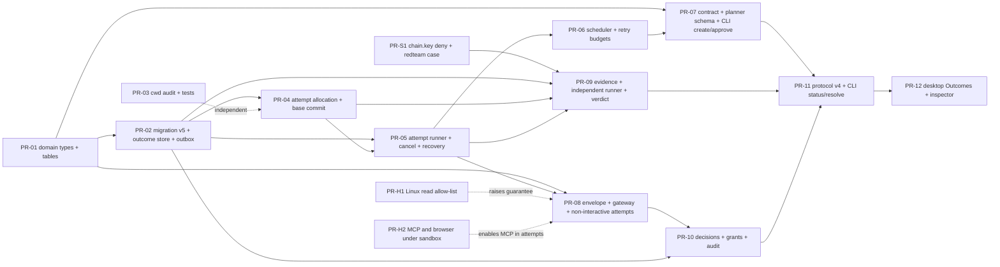

# Outcome orchestration: phased plan and PR slicing

Status: Proposed (2026-11-14). Nothing here is scheduled until the owner answers the decisions in section 7.
Inputs: [gap analysis](./outcome-orchestration-gap-analysis.md), [ADRs](./adr/README.md). Test specs: [acceptance](../testing/outcome-orchestration-acceptance.md). Threat model: [threat model](./outcome-orchestration-threat-model.md). First slice: [MVP slice](./outcome-orchestration-mvp-slice.md).

Estimates are rough guesses for one engineer plus review (S <= 2 days, M 3-5, L 6-10), not measurements. The repository rule applies to every PR: `cargo fmt --all --check`, `cargo clippy --workspace --exclude synthesis-desktop --all-targets -- -D warnings`, `cargo test --workspace --exclude synthesis-desktop` (add `-p synthesis-desktop` for desktop PRs), `node scripts/check-no-legacy-name.mjs`, and the CI job set (`ci-ok`). Every PR that touches permissions, sandbox, secrets, input validation or the store goes through the read-only security reviewer before merge (owner rule, `HANDOFF.md` 7k). Work happens in worktrees under `.claude/worktrees/`.

## 1. Phases

| Phase | Content | Exit gate |
|---|---|---|
| P0 Decisions | Owner answers D1-D12; ADRs move to Accepted; registry rows added | ADR-016..021 Accepted |
| P1 Foundations | Domain types, migration v5, cwd audit, chain-key fix | Pure tests green on 3 OS; migration test from a v4 fixture |
| P2 Execution | Attempt allocation, runner, cancel, recovery, scheduler | AC-02, AC-03, AC-04, AC-13 on macOS and Linux |
| P3 Control | Contract, envelope, gateway, decisions | AC-05, AC-06, AC-09, AC-10 (CLI), policy adversarial suite |
| P4 Evidence | Independent runner, verdict | AC-07, AC-08, forged-evidence red-team cases |
| P5 Surface | Protocol v4, CLI commands, then desktop UI | MVP definition of done ([MVP slice](./outcome-orchestration-mvp-slice.md) section 8); AC-11 on the desktop |
| P6 Hardening (parallel, already known gaps) | Linux read allow-list, MCP/browser under sandbox, rlimits | Gap analysis rows R-8 closed |
| P7 Later | Inline+Spill context, watchdog, external events, remote workers | Separate designs |

## 2. Dependency graph

Critical path to the MVP: PR-01, PR-02, PR-04, PR-05, PR-06, PR-07, PR-08, PR-10, PR-11 (PR-09 in parallel after PR-05). PR-S1 and PR-03 can start immediately and need only the decisions on naming.

## 3. PR slices

Mapping to the design's list: design PR-01 -> PR-01, PR-02 -> PR-02, PR-03 -> PR-03 (plus audit scope), PR-04 -> PR-04, PR-05 -> PR-05, PR-06 -> PR-06, PR-07 -> PR-07, PR-08 -> PR-08, PR-09 -> PR-09, PR-10 -> PR-10, PR-11 -> PR-11 and PR-12, PR-12..15 -> deferred (section 6). PR-S1 and PR-H* are new because the repo shows gaps the design does not know about.

### PR-S1 Chain key off the sandbox read path
- Scope: add `chain.key` to `synthesis_state_paths` (`synthesis-sandbox/src/lib.rs:480-497`); decide per path whether `sessions/`, `config.json`, `state.json` follow (test first); correct `docs/UNATTENDED.md:49`.
- Crates: `synthesis-sandbox`, tests in `synthesis-app/tests/state_files_protected.rs`, `tests/redteam`.
- Tests: red-team `evid-chain-key-read` (Linux bubblewrap must not read it; macOS must not read it); unit test that the path list contains it.
- Covers: ADR-020 anti-forgery, threat T-E3.
- Risk: Low; a sandboxed toolchain that wants the home dir could break (state paths are exact names, `chain.key` is not a tool path). Rollback: revert one line.
- Size: S. Security review: yes.

### PR-01 Domain types and transition tables
- Scope: `synthesis-core::outcome`: ids (UUIDv4 strings), enums `OutcomeState`, `WorkItemState`, `AttemptState`, `DecisionState`, transition functions in the style of `session.rs:48-67`, contract/plan structs (serde), plan validator (unknown dependency, cycle, unknown capability, uncovered mandatory criterion), `Envelope` type and its compile-time refusals (no allow for irreversible actions).
- Crates: `synthesis-core`.
- Tests: table-driven transition tests (every pair), property-style cycle tests, serde round trips; runs on all OSes.
- Covers: AC-01 (validation half), AC-09 (state half).
- Risk: Low (pure). Rollback: revert. Size: M.

### PR-02 Migration v5, outcome store, outbox
- Scope: `schema.rs` v5 (DDL in the [MVP slice](./outcome-orchestration-mvp-slice.md) section 3), `sessions.kind`, `synthesis-session::outcome` (CAS transitions, outbox, evidence insert API without runner), kind filters in listers and cleaners, automatic pre-migration backup (`clean.rs:431` pattern).
- Crates: `synthesis-session`, `synthesis-events` (additive event types and payload structs).
- Tests: v4 -> v5 migration fixture; CAS conflict; outbox replay after a killed writer (reuse `synthesis-session/tests/crash.rs` helpers); chain verification over outcome events (`tests/governance.rs` style); control session hidden from `list_used_sessions` and `clean`; `SchemaTooNew` for a v4 binary on a v5 DB (assert error text).
- Covers: AC-04 (store half), HARD-4, HARD-8, HARD-9.
- Risk: Medium (migration, user data). Rollback: restore the pre-v5 backup; documented. Size: L.

### PR-03 cwd scoping audit and tests (independent)
- Scope: tests and, only if a defect is found, fixes for the three entry points; store-level check that a session's `cwd` lies in `workspace_root` or an additional dir if absent (**unverified** whether it exists); desktop `Action::New` fallback becomes a refusal (decision D7).
- Crates: `apps/desktop`, `synthesis-cli-ui`, `synthesis-session`, `synthesis-app`.
- Tests: desktop `commands_fake.rs`-style test for every `Target` (`New`, `Resume`, `Model`, `Trust`, `Close`, `CloseWorkspace`), WSL `check_reported` cases, existing CLI test `synthesis-cli-ui/src/app/tests.rs:2958` kept, new store test for cwd containment.
- Covers: AC-03, HARD-3.
- Risk: Low-Medium (desktop behaviour change on D7). Rollback: revert. Size: M. Needs the desktop job (heavy); no new window tests.

### PR-04 Attempt allocation and base commit
- Scope: orchestrator-side allocation (session id first, worktree, record `GitInfo`) with crash reconcile; `WorktreeManager` option to start at a given commit (only needed after MVP; implement the API, test it, do not use it in MVP); host `commit_all` at attempt end; `retained_reason` on refused cleanup.
- Crates: `synthesis-workspace`, `synthesis-orchestrator` (new, first code), `synthesis-session`.
- Tests: crash between worktree creation and DB commit (adopt/redo); two attempts get distinct dirs, branches and sessions (extends `workspace.rs:376`); cleanup refusal keeps the tree.
- Covers: AC-02 (isolation), HARD-3.
- Risk: Medium (git on three OSes, long paths on Windows). Rollback: revert; worktrees are plain git. Size: M.

### PR-05 Attempt runner, cancel and recovery
- Scope: start a governed session for an attempt through `run::prepare`/host with the unattended profile; map `TaskStatus` to attempt state; cancel via stop path and process-tree kill; orchestrator startup recovery (lost attempts, outbox replay) with a recovery report event.
- Crates: `synthesis-orchestrator`, `synthesis-app`.
- Tests: fake provider (`test-provider` feature) attempt end-to-end; kill -9 the orchestrator mid-attempt and recover (new e2e `outcome_recovery`); cancel kills a spawning tree within a bound (AC-13).
- Covers: AC-04, AC-13, AC-15, HARD-8.
- Risk: High (concurrency, process lifetime, Windows flake pattern at `docs/STATUS.md` SQLite lock). Rollback: feature flag `synt.outcomes.enabled` default off. Size: L.

### PR-06 Scheduler and retry budgets
- Scope: bounded-parallel DAG walk, canonical ordering, retry budget per work item, blocked state with reason; no resource locks yet.
- Crates: `synthesis-orchestrator`.
- Tests: synthetic DAG with injected failures (design Phase 3 gate): no duplicate assignment, no cycle, retries bounded, 1,000 queued items do not spawn more than the cap (stub attempts).
- Covers: AC-02 (parallelism), AC-07.
- Risk: Medium. Rollback: flag. Size: M.

### PR-07 Contract, planner schema, `synt outcome create|approve`
- Scope: contract editor in CLI form (goal, criteria with optional check commands, envelope), approval records the contract hash; deterministic stub planner (inspect -> implement -> test); planner JSON schema validation; model planner behind the same schema later.
- Crates: `synthesis-orchestrator`, `apps/cli` (`synthesis-app` command wiring).
- Tests: schema rejections; approval hash stability; contract immutability.
- Covers: AC-01.
- Risk: Low-Medium. Size: M.

### PR-08 Envelope compiler, gateway, non-interactive attempts
- Scope: envelope -> rules/mode/sandbox/budget compile; `OrchGateway`; attempt launch profile (no bypass, no auto judge, no Always, no project trust, no MCP unless listed); `AskUserQuestion` and denials recorded as `needs_decision` (ADR-019 section 2).
- Crates: `synthesis-orchestrator`, `synthesis-permissions` (only if a hook is missing; prefer none), `synthesis-app`.
- Tests: golden compile tests; fuzz: no generated allow for any `irreversible.rs` action; red-team cases (threat model) in all four modes; AC-05, AC-06.
- Risk: High (security). Rollback: flag. Size: L. Security review: mandatory, two rounds expected.

### PR-09 Evidence, independent runner, verdict
- Scope: `evidence` writes, host-side runner on a detached checkout, trust classes, pure `verdict`, stale marking, environment fingerprint.
- Crates: `synthesis-verification`, `synthesis-orchestrator`, `synthesis-session`.
- Tests: exhaustive verdict table; forged report file does not clear the gate; `definitions_changed` blocks; stale commit rejected; fence rejection; runner refuses without enforce.
- Covers: AC-08, forged-evidence cases.
- Risk: High (runs agent-written tests on the host under the sandbox). Rollback: flag. Size: L. Security review: mandatory.

### PR-10 Decisions, grants, audit
- Scope: decision lifecycle, brief builder, dedupe, bindings, expiry timer, invalidation on contract/plan/commit/policy change, one-shot grant that starts a new attempt, `policy.decision` events.
- Crates: `synthesis-orchestrator`, `synthesis-session`.
- Tests: stale decision replay after a commit change is rejected; revoked grant; expiry moves to HOLD, never approve; dedupe; no default choice in the brief schema; AC-09, AC-10 (data shape).
- Risk: Medium-High. Size: L. Security review: yes.

### PR-11 Protocol v4 and CLI surface
- Scope: `PROTOCOL = 4`, methods of ADR-021, `synt outcome status|decisions|resolve|cancel|inspect`, event cursor, `decision` push line, projection tests in `synthesis-view`.
- Crates: `synthesis-app`, `synthesis-view`, `apps/cli`.
- Tests: protocol golden lines, hostile-engine cases (unsolicited resolve), reconnect with `after_seq`; `engine_stdio.rs` extended.
- Covers: AC-10 (full), AC-11 (data), AC-12.
- Risk: Medium (lock-step version). Size: M.

### PR-12 Desktop Outcomes, Decisions, one inspector (after MVP)
- Scope: per ADR-021; `synthesis-view` models; `tui_view` panels; design tests.
- Crates: `apps/desktop`, `synthesis-view`.
- Tests: `design_tests` bounds for the new rows, snapshot of the decision card, a rule test that no option is preselected.
- Covers: AC-10 (UI), AC-11 (UI), HARD-11.
- Risk: High (UI regressions, CI desktop job, owner design not final). Size: L (likely two PRs). Blocked on D5/D6.

### PR-H1, H2, H3 Known hardening (already listed by the owner, `docs/specs/sandbox-hardening.md` sections 2-4)
- H1 Linux read allow-list; H2 MCP stdio and browser worker under the sandbox; H3 rlimits and disk quota. They are not prerequisites of the MVP but each one upgrades what the UI may claim (ADR-018 item 9) and closes risks R-8. H4 (Windows AppContainer) needs an ADR-010 exception (decision D3).

## 4. Cross-platform requirements

- Pure logic (domain, validator, scheduler with stub attempts, verdict, brief builder, envelope compiler, store) must pass on macOS, Linux and Windows CI from the first PR; tests may not depend on `$HOME`, `TERM`/`COLORTERM` or a non-symlinked temp dir (macOS `/var` -> `/private/var`, CLAUDE.md).
- Paths: canonicalise with `synthesis_core::canonicalize`; case-fold on win32 and darwin (`PathPolicy`); spawn Windows system tools by absolute `System32` path; kill whole process trees (group on POSIX, `taskkill /T` on Windows); never rewrite `\` to `/` on POSIX.
- Execution tests (attempt runner, independent runner, red-team) run on macOS and Linux (`EVAL_SANDBOX=enforce` as in the `redteam` job); on Windows they are skipped with an explicit reason and the orchestrator refuses writable attempts natively (ADR-018 item 5). Windows users reach outcomes through the WSL engine (ADR-015); the WSL path is verified only by CI plus the owner's manual `#[ignore]` test (`docs/SECURITY.md:44`), **unverified** on real hardware.
- SQLite on Windows showed lock contention on event append (`docs/STATUS.md` Verified, retried since PR #55): orchestrator tests must not hammer one DB from many threads.
- Environment: orchestrator code takes `&Env` (injectable); child environments stay the existing allowlist.
- New CI jobs: none for the MVP. Extend `test`, `redteam` (new case ids), `sandbox-linux` (chain-key read) and the desktop job (PR-12 only). Add the new test files to the existing jobs rather than creating jobs, to keep `ci-ok` stable.

## 5. Rollback and feature flag

All orchestration code is behind `synt.outcomes.enabled` (user or managed setting, default false; a project file can never enable it). With it off: no migration side effects beyond the additive v5 tables, no new commands listed in `--help` (hidden), no UI. The only irreversible step is the v5 migration; its mitigation is the automatic backup (ADR-016 item 9).

## 6. Deliberately deferred

External event adapters and inbox (design PR-14, AC-14); remote workers and `WorkerTransport` (PR-15); Inline+Spill context and scoped retrieval (PR-12 of the design; the existing memory store, ADR-013, covers part of it); watchdog and adaptive recovery ladder (PR-13; local liveness is the OS lock); model planner and replanner (stub planner first); merge and push (D8); resource locks beyond the integration key; Cedar; multi-approver roles; telemetry export and the design's metric names (events provide the counters locally); MCP in attempts; auto judge in attempts; native Windows execution; daemon.

## 7. Open owner decisions (recommended default)

| Id | Decision | Recommended default | Blocks |
|---|---|---|---|
| D1 | Amend ADR-009 to allow an orchestrator (scoped to outcome mode, opt-in) | Yes, behind `synt.outcomes.enabled`, off by default | Everything |
| D2 | Outcome state in `synt.db` via a hidden control session (vs separate DB) | Control session | PR-02 |
| D3 | Native Windows: refuse orchestrated writable attempts; WSL only; AppContainer later via ADR-010 exception | Refuse | PR-05 |
| D4 | Orchestrator lifetime: in-process and headless process, no daemon | No daemon | PR-05 |
| D5 | Outcomes placement in the desktop | Inside the TUI view; CLI first | PR-12 |
| D6 | Inspector: one tabbed container in the right drawer region (needs the owner's design) | As ADR-021 item 3 | PR-12 |
| D7 | Desktop `/new` with no selected workspace | Refuse with a visible note | PR-03 |
| D8 | Merge and push in the first release | Neither: branch and patch only | PR-10 scope |
| D9 | Worktree retention after an outcome closes | 7 days, never auto-delete dirty trees | PR-04 |
| D10 | Budgets | Cost cap required per outcome (no default amount); per attempt the desktop default of 10 USD (`docs/UNATTENDED.md:23`); `max_parallel_workers` 2; retries per work item 2 | PR-06 |
| D11 | Auto judge in attempts | Off | PR-08 |
| D12 | MCP servers in attempts | None unless listed in the contract with the weaker-isolation notice | PR-08 |
| D13 | Planner | Deterministic stub first, model planner after the gate | PR-07 |
| D14 | Approver model | Single local user | PR-10 |
| D15 | Extra state paths to deny beyond `chain.key` | Decide per path with a test | PR-S1 |
| D16 | Data retention and export for outcome data | Same as sessions (no cleanup yet); `synt outcome export` after MVP | later |

## 8. Risks specific to the plan

- The control-session idea is the least conventional choice; if the owner prefers a separate store (D2), PR-02 grows (own chain code) by roughly one size step.
- PR-05 and PR-08 together carry most of the risk; do not merge PR-05 without the flag.
- The desktop job and `design_tests` are the slowest and flakiest gates; the plan keeps the engine testable without them.
- Estimates do not include owner review latency or CI reruns of known flaky jobs (`docs/STATUS.md`).
