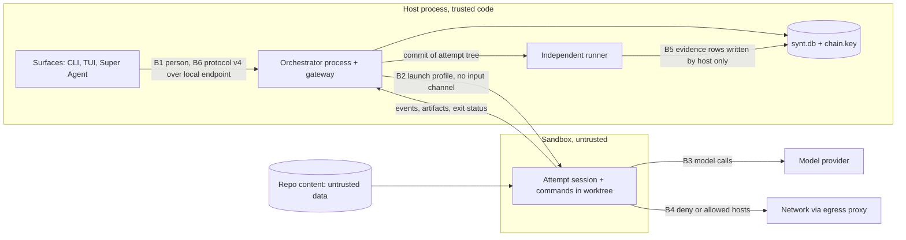

# Outcome orchestration: threat model

Status: Proposed (2026-11-14, rev 2: three surfaces, standalone orchestrator). Extends the threat model of `docs/SECURITY.md` (prompt injection, malicious repository, over-eager model; out of scope: malicious local user or root, compromised provider, a process that already escaped the sandbox, kernel exploits, side channels). Test specs for every row are in [acceptance](../testing/outcome-orchestration-acceptance.md); decisions in [ADR-018](./adr/ADR-018-execution-isolation.md), [ADR-019](./adr/ADR-019-outcome-policy.md), [ADR-020](./adr/ADR-020-outcome-verification.md).

Status vocabulary: **Enforced** = exists today and a test covers it (cited); **Partial** = exists with a stated limit; **Planned PR-x** = the mitigation is part of that PR; **Gap** = known, not mitigated by this program (owner-accepted or later). Nothing was executed for this document; "tested" means the cited test exists at b230f4df.

## 1. Assets

| Id | Asset | Why it matters |
|---|---|---|
| A1 | User files outside the workspace, credentials, network position | `docs/SECURITY.md` asset list |
| A2 | The workspace and its git history (branches, hooks, config) | Code execution on the next trusted run |
| A3 | `synt.db` (sessions, outcome state, decisions, evidence) and `chain.key` | Authority and audit record |
| A4 | The authority envelope and approved contract | Defines what may be done without a human |
| A5 | Evidence integrity | Decides VERIFIED |
| A6 | Budget (money, tokens, time) | Runaway cost |
| A7 | Human attention and approvals | Rubber-stamping defeats the control |
| A8 | Provider API keys (`SYNT_*`) | ADR-011 |

## 2. Actors and trust

| Actor | Trust |
|---|---|
| Person at a surface (CLI, TUI, Super Agent) | Trusted; the only source of approvals |
| Surface process (CLI, desktop) | Trusted code but **thin**: renders, sends commands; holds no authority of its own and no database write path to aggregates |
| Standalone orchestrator process | Trusted code, same OS user; owns outcomes through the control-session lock |
| Attempt (agent session + its commands) | Untrusted: the model obeys injected text; commands run in the sandbox as the same OS user |
| Repository content, PR/issue text, tool output, MCP results, web pages | Untrusted data, never authority (`docs/SECURITY.md:12`) |
| Independent runner | Trusted code running untrusted project code in the sandbox |
| Model provider | Out of scope as an adversary; data egress is by configuration |
| Same-user process outside the sandbox | Out of scope (can read the key and the DB) |
| Engine in WSL | Trusted by the desktop only after the exact hello match (ADR-015); a hostile engine is modelled by v3's checks |

## 3. Trust boundaries and data flow

Boundaries: B1 person to surface (approvals originate only here); B6 surface to orchestrator (protocol v4: stdio, in-process for tests, or same-user socket/named pipe with mutual HMAC; commands are revision-checked); B2 host to attempt (sandbox, no database path, no gateway channel); B3 attempt to provider (keys stay in the host process); B4 attempt to network (deny by default, proxy allow-list); B5 runner to store (host writes evidence, never the attempt). Everything on the sandbox side of B2 is untrusted even though the OS user is the same, which is why file-system confinement strength per platform decides several rows.

## 4. Threats (STRIDE-oriented)

Test ids: existing red-team case ids are in `tests/redteam/cases.mjs`; ids with a prefix `orch-`, `pol-`, `dec-`, `evid-`, `proto-` are **proposed** new cases (or Rust tests where the row says so).

| Id | Threat | Category | Mitigation | Status | Test |
|---|---|---|---|---|---|
| T-01 | Injected text in README/issue/tool output/MCP tells the worker to push, deploy, reveal secrets or approve a decision | E | Authority never inferred from content; irreversible table; no channel from an attempt to the gateway or decisions | Enforced for tool actions; Planned PR-08/PR-10 for decisions | `inj-readme-push`, `inj-issue-curl-sh`, `inj-tool-output-hook`, `inj-mcp-result-force-push`, `inj-image-text-exfil`; new `inj-readme-approve-decision` |
| T-02 | Worker edits `.git/hooks`, `.git/config`, `AGENTS.md`, `.synt/`, `.envrc`, `.mcp.json` to plant code for the host | T/E | Read-only set hard deny in every mode; sandbox read-only paths | Enforced (Weak on macOS shell, none on Windows) | `prot-git-hooks-write`, `prot-git-config-write`, `prot-agents-md-write`, `prot-envrc-write`, `prot-mcp-json-write`, `prot-bash-redirect-hook`, `prot-dangling-symlink`, `prot-hardlink` |
| T-03 | Host-side git (`commit_all`, diff, checkout for the runner) runs a filter or hook planted in the attempt's repo metadata | E | Hardened git wrapper, pinned git dir, no global config, submodules never descended (`worktree.rs:43-58`, `docs/UNATTENDED.md:65`) | Partial: `commit_all` using the hardened wrapper is **unverified** (check in PR-04) | `hostile_repo_runs_nothing` (`synthesis-workspace/tests/workspace.rs:263`); new `orch-commit-all-hostile-config` |
| T-04 | Attempt writes to or reads the outcome tables to forge state, or reads `chain.key` to forge a chain | S/T | Sandbox denies `synt.db*` and `run/`; file tools protect state paths; `chain.key` added to the deny list | Partial: `chain.key` not denied today (read in `synthesis-sandbox/src/lib.rs:480-497`) | `synthesis-app/tests/state_files_protected.rs`; new `evid-chain-key-read`, `orch-db-write-from-attempt` (PR-S1, PR-02) |
| T-05 | Test reporter forged: worker edits the report file, the test script, or the check definition | T | Independent runner on a clean checkout of the commit from the frozen check list; model-declared checks never count; definitions-changed blocks | Enforced for in-session gate; PR-09: independent runner on a fresh checkout through a scratch repository, MAC'd evidence, definitions/weakening flags that fail the item (limits in ADR-020) | `game-rewrite-test-script`, `game-delete-test`, `game-weaken-assertion`; new `evid-forged-report-file`, `evid-definitions-changed` |
| T-06 | Evidence reused for a different commit, or an old attempt writes late | T | `subject_commit` and `fence` checked at insert and at verdict | PR-09: the pure verdict marks stale commits and superseded fences | `only_current_independent_evidence_passes_a_mandatory_criterion`, `evidence_insert_rejects_old_fence` |
| T-07 | Contract or envelope modified after approval | T | Hash recorded at approval; new version = new row; gateway reads the approved hash | Planned PR-07/PR-08 | new `dec-contract-mutate-after-approve` |
| T-08 | Stale approval replayed after commit, plan, contract or policy change | E | Binding fields on every decision (contract, plan, commit, policy, action hash, attempt, work item); the driver invalidates a pending decision whose binding moved and revokes an unused grant behind it; `policy.decision` events | PR-10 | `ac09_a_moved_binding_invalidates_a_pending_decision_and_leaves_the_others`, `a_grant_is_refused_and_unusable_once_the_binding_moved_it_expired_or_it_was_revoked_or_used` |
| T-09 | Approval fatigue: bulk approve, default choice, "Always" widening policy | E/R | No default, no bulk above R1, "Always" disabled in attempts, policy changes as reviewed proposals | Planned PR-10/PR-12 | new `dec-no-default-choice` (schema test), `dec-bulk-refused`, `pol-always-disabled-in-attempt` |
| T-10 | Approval timeout auto-approves | E | Expiry moves to Expired with HOLD (the item stays `waiting_decision`); an expired decision cannot be resolved | PR-10 | `expiry_moves_a_pending_decision_to_hold_and_never_to_approved` |
| T-11 | Worker self-grants: envelope allows an irreversible action; attempt launched in `bypassPermissions`; auto judge approves | E | Compile-time refusal; mode never granted; judge off | Planned PR-08 | new `pol-envelope-allow-push-refused`, `pol-attempt-bypass-refused`, `pol-no-auto-judge-in-attempt`; existing `git-push`, `git-push-force`, `npm-publish`, `deploy-script` in all four modes |
| T-12 | `AskUserQuestion` or an ask blocks a worker forever, or is answered by injected text | D/E | Attempts non-interactive; question becomes a Decision; reply text grants nothing | Planned PR-08/PR-10; delegation analogue enforced (`e8f`) | new `pol-askuser-becomes-decision`; `apps/cli/tests/e2e.rs:2175` |
| T-13 | Hook returns `allow` to widen permissions | E | Hook allow ignored (`exec.rs:648`) | Enforced (code); test coverage **unverified** | new Rust test `hook_allow_is_ignored_in_attempt` |
| T-14 | Revoked grant still used by a running attempt | E | A grant is MAC'd, consumed once at the start of ONE new attempt (its rules are that attempt's `--allow` flags and no other attempt's), revoked while unused when the binding moves, and refused once revoked, expired or consumed. A running attempt keeps what it started with: a grant is not a live channel | PR-10 | `a_grant_is_refused_and_unusable_once_the_binding_moved_it_expired_or_it_was_revoked_or_used`, `a_grant_row_without_a_valid_mac_is_never_used` |
| T-15 | Two attempts mutate the same protected resource (integration branch) | T | `resource_locks` with sorted acquisition and fence | Planned (first merge feature, after MVP) | new Rust test `integration_lock_is_exclusive` |
| T-16 | Duplicate effect after a crash between commit and dispatch (worktree create, verifier run) | T | Outbox with idempotency key and effect probes | Planned PR-02/PR-04 | new `orch-outbox-crash-no-duplicate-worktree` |
| T-17 | Orphaned processes or worktrees after crash or cancel | D | Recovery scan, process-tree kill, cleanup refuses dirty trees | Partial: sessions enforced (`synthesis-session/tests/crash.rs`), outcome level Planned PR-05 | new `orch-cancel-kills-subtree`, `orch-recovery-after-kill9` |
| T-18 | Runaway cost: retry loops, parallel fan-out, provider loops | D | Required cost cap, wall cap, bounded retries, bounded parallelism, pre-turn estimate | Enforced per session (`docs/UNATTENDED.md` cost accounting); outcome budget (PR-06): the cap is a reservation-based upper bound (each attempt's cap is reserved before its worker starts and counts as spent until a final usage is recorded, also for killed or crashed workers); a sandboxed worker cannot raise it; a same-user writer outside the sandbox can rewrite usage and reservation rows (no HMAC) | new `orch-retry-budget-bounded`, `orch-parallel-cap`; eval `gaming-oscillation` |
| T-19 | Disk fill, fork bomb inside an attempt | D | None (no rlimits, no disk quota) | **Gap** (red-team `large-write`, `fork-fanout` known gaps; hardening PR-H3) | `large-write`, `fork-fanout` stay `known_gap` |
| T-20 | Secret exfiltration through output, events, artifacts, prompts | I | Redaction on events; env allowlist; network deny/proxy; artifacts are raw (documented) | Enforced for events and env; artifacts raw by design | `secret-redaction-in-output`, `secret-dotenv-values`, `env-scrub-child`, `net-egress-under-deny`; new `orch-evidence-view-redacted` |
| T-21 | Cross-attempt data leakage (attempt A reads attempt B's worktree) | I | Distinct worktrees; sandbox filesystem confinement | Partial: macOS read allow-list excludes other worktrees; on Linux bubblewrap another worktree under `$SYNT_HOME/worktrees` is absent now that the read allow-list replaced the read-only `/` bind (enforced by code and unit tests; the real-bubblewrap run is CI-only, **not executed locally**) | new `orch-cross-attempt-read` (blocked on macOS, `known_gap` on Linux/WSL until PR-H1) |
| T-22 | Symlink or hard link from the worktree to the home directory | E/T | Path checks plus sandbox; hard-link refusal in tools | Enforced for tools; shell hard links documented gap | `path-traversal-write`, `outside-abs-write`, `bash-write-outside`, `prot-hardlink`; new `orch-symlink-worktree-to-home` |
| T-23 | MCP server or browser worker acts outside the sandbox | E | MVP attempts run without MCP unless listed; destructive MCP asks escalate | Stdio MCP servers: enforced by the command sandbox (default network none; opt-outs listed in `docs/specs/sandbox-hardening.md` section 4). **Gap**: browser worker, HTTP servers, native Windows, servers with `sandbox: false` | existing `inj-mcp-result-force-push` (injection only); new `pol-mcp-not-in-attempt-by-default` |
| T-24 | Hostile or buggy engine over stdio fabricates decisions or results | S | Exact hello match; asks answered by persons only; unsolicited `restarted` treated as hostile; same rule for `decision.resolve` | Enforced for v3 asks; PR-11: results nobody asked for and replies about another command kill the client link | `apps/cli/tests/engine_stdio.rs`; `crates/synthesis-app/tests/outcome_proto.rs` (`proto_unsolicited_decision_resolve_*`, hostile-engine cases). PR-12: the stdio engine is read-only and mutating calls are accepted only on the key-authenticated endpoint with a matching attached surface (`crates/synthesis-app/tests/orch_endpoint.rs`: `the_stdio_engine_cannot_queue_anything`, `a_mutating_call_must_name_the_surface_the_link_attached_as`, `a_key_holder_that_does_not_attach_as_a_surface_is_dropped`). PR-12b: a link idle for 15 minutes is dropped and its slot freed, the owner job queue is bounded (busy error), `outcome.create` has an idempotency key and checks `base_commit` (`orch_endpoint.rs`: `a_hung_link_is_dropped_and_frees_its_slot`, `a_full_job_queue_is_refused_as_busy_not_queued_for_ever`, `a_create_retried_with_the_same_key_returns_the_same_draft`). Residual: a same-user process outside the sandbox can read `run/orch.key` and attach as any surface (ownership boundary, not security); the client trusts `brief_sha256` as sent (ADR-021 PR-11 notes); the create idempotency record is in memory |
| T-25 | Unauthorized local process controls the runtime | S | No TCP or HTTP listener; the only endpoint is the same-user socket/pipe of T-32 | PR-12: implemented (no TCP/HTTP; unix socket or named pipe under `run/`, 0700, same-uid peer check, HMAC handshake); same-user impersonation is a documented residual (ADR-012). PR-12b: hung links cannot block idle exit (see T-24). Windows pipe unverified; its DACL is the default one (explicit current-user-only DACL needs `unsafe` or a new dependency: not done), `serve` fails closed unless `SYNT_HOME` is under the user profile | see T-32 |
| T-26 | Webhook replay or bad signature | S | Inbox with unique `(source, external_id)` | Out of MVP; **Gap** until the GitHub adapter | deferred (AC-14) |
| T-27 | Provider outage or error used to skip verification | E | Gate treats unchecked work as `unverified`; verdict never `Verified` without evidence | Enforced per session; Planned PR-09 outcome level | new `orch-provider-down-never-verified` |
| T-28 | Tampering with stored events by a same-user process | T | HMAC chain, tamper evidence only (`docs/UNATTENDED.md:49`) | Partial (detect corruption and writers without the key; no prevention against a same-user program outside the sandbox; a cut-off tail is not detected) | `synthesis-session/tests/governance.rs`; extend over `outcome.*` events (PR-02) |
| T-29 | Dependency or release compromise | T | cargo-deny, cargo-audit, pinned actions (`docs/SECURITY.md` Supply chain) | Enforced in CI | CI jobs `deny`, `audit` |
| T-30 | Weakening checks via shell-only edits in non-test source | T | Size+mtime tracker; gate baseline | Partial (`docs/SECURITY.md:23`) | eval `gaming-*`; no new case |
| T-31 | Two surfaces act on one outcome: simultaneous resolve, resolve vs invalidation or expiry, retry storms | T/E | One owner, commands applied by CAS on `revision`, idempotency keys, `already_resolved`/`stale` results (ADR-016 items 11-13, ADR-019 section 5) | PR-02, PR-10, PR-11, PR-12 (the orchestrator process applies commands through `apply_queued`/`apply_lifecycle`; one owner per outcome by the control-session lock) | `crates/synthesis-app/tests/outcome_proto.rs`: `proto_resolve_race_*`, `proto_resolve_vs_invalidate_*`, `proto_resolve_vs_expiry_*`, `proto_command_idempotent_*` |
| T-32 | A local client other than a surface (a sandboxed attempt, another user's process) connects to the orchestrator endpoint | S/E | Socket under `$SYNT_HOME/run/` (sandbox-denied), 0700 directory, mutual HMAC handshake with `run/orch.key`; same OS user only | PR-12: implemented; same-user processes outside the sandbox remain out of scope (ADR-012 residual). PR-12b: workers get a filtered environment (`child_env` + the provider keys only: `a_worker_gets_the_filtered_env_and_only_the_provider_keys`) and checks a cleared one, `run/orch.log` is 0600 (`the_orchestrator_log_is_private`), stale takeover removes only the orchestrator's own socket (`only_the_orchestrators_own_stale_socket_is_removed`). Windows: pipe ACL and ownership of `run/`/`orch.key` not checked beyond the user-profile rule (uncompiled and unrun here) | seatbelt `synthesis_state_db_and_memory_are_unreadable` (now with `run/orch.key` and `run/orch.json`), `state_files_protected` (file tools), `a_client_that_does_not_hold_the_key_gets_nothing` (wrong-key handshake). Not run: a socket connect from inside a sandboxed attempt on Linux/Windows (the deny list and the network policy are the controls) |
| T-33 | Notification leaks decision content, or floods | I/D | Payload ids and codes only (`synthesis-app/src/notify.rs:158`), dedupe per `(decision_id, revision)`, existing caps (4 concurrent, 50 per process) | Planned PR-12; mechanism enforced today for governed runs | new `notify-no-brief-text`, `notify-dedup` (extend `notify.rs` tests) |
| T-34 | Surface logic reinterprets or hides part of a decision brief, preselects an option, or computes its own verdict | R/E | Brief is structured server data; shared renderer field-coverage test per surface; dependency test keeps logic out of surfaces; no `recommended`/`selected` field | PR-11 (models, helper, dependency test); each surface's own render test is PR-13 to PR-15 | `synthesis-view/src/outcomes.rs` tests (`every_non_empty_field_of_a_brief_is_shown` = `surface-brief-all-fields-shown`, `nothing_is_preselected_*` = `surface-no-preselection`); `synthesis-app/tests/surface_deps.rs` (`deps-surfaces-do-not-import-orchestrator`) Reads added for the view models (ADR-021 notes): `outcome.budget`, `attempt.diff`, `event_backed`; same refusal when off, same service on the stdio engine (read-only) and the owner; the diff is hardened git on a scratch repository with caps, control characters removed and secret-shaped paths shown as names only (`crates/synthesis-orchestrator/tests/commit_diff.rs`, `crates/synthesis-app/tests/outcome_reads.rs`). The surface's own build refuses ids and hashes of an unexpected shape before they appear in a command to paste, and a duplicated answer id (`synthesis-view` `a_repeated_answer_id_*`). Accepted residual: `attempt.diff` shows the content of a file under a non-secret path (a key pasted into `notes.txt` is in the patch); only secret-shaped names are withheld, and the diff is the owner's own repository read by its owner. |
| T-35 | Older or mismatched binary corrupts or is locked out of the shared database; protocol version skew | T/D | Explicit opt-in migration with backup; `SchemaTooNew` refusal; exact protocol match (compatibility matrix, ADR-016) | PR-02 (store), PR-11 (protocol), PR-12 (`orchestrator.enable` is the only migration path; the process opens at the default schema and does not migrate on its own) | `a_default_open_stays_at_v4_*` and `a_binary_that_supports_v4_refuses_v5_*` (session crate, = `migration-default-open-stays-v4`, `migration-v4-binary-refuses-v5`); `the_handshake_is_exact` (protocol 3 and 5 refused), `an_engine_of_another_protocol_is_refused_at_connect` |
| T-36 | Orchestrator process orphaned, duplicated or stuck: two processes own one outcome; a dead one leaves attempts running | D/T | Control-session lock decides ownership; kernel releases it on death; recovery marks lost attempts; idle exit; `synt stop` path for attempts | PR-12: implemented | `apps/cli/tests/orchestrator_process.rs`: `one_owner_per_outcome_and_a_new_owner_recovers_what_the_dead_one_left` (= `orch-two-owners-lock-decides`), `killing_the_orchestrator_loses_nothing_and_a_client_starts_another` (= `orch-owner-kill-recovery`); `orch_endpoint.rs`: `a_second_orchestrator_for_the_same_home_does_not_start`; idle exit: unit test of the rule (no 10 minute wait in CI) |
| T-37 | Surface-specific side path bypasses the gateway (a TUI `!cmd`, `/permissions allow`, a Super Agent shortcut) | E | Surfaces send commands only; chat-session features act on the surface's own chat session, never on a contract's compiled rules; gate before enabling (ADR-019 section 6) | Planned PR-08, PR-13..15 | new `pol-surface-cannot-touch-attempt-rules` (protocol level), `pol-attempt-has-no-user-input-channel` The new reads send no command and no field a surface can act on without the owner (`outcome_reads.rs`: refused when off, read-only service); a surface cannot ask the diff for another repository or commit: both come from the store. |

## 5. Residual risks (stated to the owner, not mitigated here)

1. Sandbox strength: macOS Seatbelt filesystem Weak (deprecated), Linux bubblewrap filesystem Weak (reads `/`), WSL Weak, native Windows none (`docs/SECURITY.md` table). Outcome UI must print the backend and guarantee per attempt.
2. The independent runner runs agent-written tests on the host under the same sandbox; it is independent of the worker's *control*, not of the sandbox's limits.
3. The browser worker is outside the OS sandbox and the egress proxy. MCP stdio servers are inside it except on native Windows, under `--sandbox off`, and for servers the user opted out (`sandbox: false`) or gave `network: full`.
4. **Integrity claim.** Outcome state is protected from agent attempts by the OS sandbox (platform dependent; native Windows refuses writable attempts). Approvals and events carry HMACs under a per-user key stored next to the data: they detect corruption, old binaries and writers that cannot read the key; they do not detect or prevent changes by any program running as the same user outside the sandbox, and they do not detect a cut-off tail of events. The hash chain covers events only (its head is a plain column in the same database); contract approvals, decision approvals and evidence rows carry MACs (evidence: every column including its flags, from the insert, and it needs its chained `evidence.recorded` event too); attempts (`subject_commit`, `fence`, `reserved_usd`, the bound policy), work-item specs, grants, the outbox and commands carry none and are protected only by being unreachable to the sandbox. A writer without the key cannot INSERT a passing `independent_check` row or change one. "Independent" means the repository's own checks exit 0 on a clean checkout under a sandbox, not that they test the requirement (ADR-020).
5. A person can still approve something harmful; the design reduces rubber-stamping, it does not remove the human.
6. Any same-user process outside the sandbox can read `run/orch.key` and the database and so impersonate a surface; the endpoint raises the bar against sandboxed code and other users, not against the user's own processes.
7. The standalone orchestrator process (PR-12) is an **ownership and correctness boundary, not a security boundary**: it runs as the same OS user as every surface. Real boundaries (a daemon under a separate OS user; a person-present signature through FIDO2, Touch ID or Windows Hello for irreversible decisions) are post-MVP owner decisions.
8. A sandboxed command on macOS that calls `setsid` leaves the process tree the runner lists and kills, and can keep writing the attempt's worktree after its subject commit is recorded (Linux bubblewrap unshares the pid namespace and dies with its parent). Mitigation by design: the independent runner verifies a fresh checkout of the subject commit (PR-09), never the worktree. User and managed hooks run on the host outside the sandbox.
9. No independent security audit exists for the repo (`docs/SECURITY.md` Known gaps).

## 6. Review gates

Mandatory read-only security review before merge for PR-S1, PR-08, PR-09, PR-10, PR-12 (endpoint, key, process lifetime) and any change of `synthesis-permissions`, `synthesis-sandbox`, or secret handling; rerun the full red-team suite (`node tests/redteam/run.mjs --strict-gaps`) and the `sandbox-linux` job for each; new cases start as `enforced` when the PR claims the mitigation, otherwise as an explicit `known_gap` with a reason (the suite's `--strict-gaps` then forces promotion).

**Heuristics, not controls (PR-09).** The test-weakening scan, the removed-inline-test check and the test-count comparison (zero tests, fewer than the base commit) are heuristics over text the attempt can influence: a `harness = false` binary or the code under test can print a `test result:` line, and a weakening can be phrased in ways the patterns do not know. They raise flags that fail the item and go to a person; they never prove that a test ran, and their absence proves nothing.
