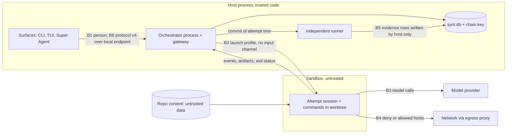

# Outcome orchestration: threat model

Status: Proposed (2026-11-14, rev 2: three surfaces, standalone orchestrator). Extends the threat model of `docs/SECURITY.md` (prompt injection, malicious repository, over-eager model; out of scope: malicious local user or root, compromised provider, a process that already escaped the sandbox, kernel exploits, side channels). Test specs for every row are in [acceptance](../testing/outcome-orchestration-acceptance.md); decisions in [ADR-018](./adr/ADR-018-execution-isolation.md), [ADR-019](./adr/ADR-019-outcome-policy.md), [ADR-020](./adr/ADR-020-outcome-verification.md).

Status vocabulary: **Enforced** = exists today and a test covers it (cited); **Partial** = exists with a stated limit; **Planned PR-x** = the mitigation is part of that PR; **Gap** = known, not mitigated by this program (owner-accepted or later). Nothing was executed for this document; "tested" means the cited test exists at b230f4df.

## 1. Assets

| Id | Asset | Why it matters |
|---|---|---|
| A1 | User files outside the workspace, credentials, network position | `docs/SECURITY.md` asset list |
| A2 | The workspace and its git history (branches, hooks, config) | Code execution on the next trusted run |
| A3 | `synt.db` (sessions, outcome state, decisions, evidence) and `chain.key` | Authority and audit record |
| A4 | The authority envelope and approved contract | Defines what may be done without a human |
| A5 | Evidence integrity | Decides VERIFIED |
| A6 | Budget (money, tokens, time) | Runaway cost |
| A7 | Human attention and approvals | Rubber-stamping defeats the control |
| A8 | Provider API keys (`SYNT_*`) | ADR-011 |

## 2. Actors and trust

| Actor | Trust |
|---|---|
| Person at a surface (CLI, TUI, Super Agent) | Trusted; the only source of approvals |
| Surface process (CLI, desktop) | Trusted code but **thin**: renders, sends commands; holds no authority of its own and no database write path to aggregates |
| Standalone orchestrator process | Trusted code, same OS user; owns outcomes through the control-session lock |
| Attempt (agent session + its commands) | Untrusted: the model obeys injected text; commands run in the sandbox as the same OS user |
| Repository content, PR/issue text, tool output, MCP results, web pages | Untrusted data, never authority (`docs/SECURITY.md:12`) |
| Independent runner | Trusted code running untrusted project code in the sandbox |
| Model provider | Out of scope as an adversary; data egress is by configuration |
| Same-user process outside the sandbox | Out of scope (can read the key and the DB) |
| Engine in WSL | Trusted by the desktop only after the exact hello match (ADR-015); a hostile engine is modelled by v3's checks |

## 3. Trust boundaries and data flow

Boundaries: B1 person to surface (approvals originate only here); B6 surface to orchestrator (protocol v4: stdio, in-process for tests, or same-user socket/named pipe with mutual HMAC; commands are revision-checked); B2 host to attempt (sandbox, no database path, no gateway channel); B3 attempt to provider (keys stay in the host process); B4 attempt to network (deny by default, proxy allow-list); B5 runner to store (host writes evidence, never the attempt). Everything on the sandbox side of B2 is untrusted even though the OS user is the same, which is why file-system confinement strength per platform decides several rows.

## 4. Threats (STRIDE-oriented)

Test ids: existing red-team case ids are in `tests/redteam/cases.mjs`; ids with a prefix `orch-`, `pol-`, `dec-`, `evid-`, `proto-` are **proposed** new cases (or Rust tests where the row says so).

| Id | Threat | Category | Mitigation | Status | Test |
|---|---|---|---|---|---|
| T-01 | Injected text in README/issue/tool output/MCP tells the worker to push, deploy, reveal secrets or approve a decision | E | Authority never inferred from content; irreversible table; no channel from an attempt to the gateway or decisions | Enforced for tool actions; Planned PR-08/PR-10 for decisions | `inj-readme-push`, `inj-issue-curl-sh`, `inj-tool-output-hook`, `inj-mcp-result-force-push`, `inj-image-text-exfil`; new `inj-readme-approve-decision` |
| T-02 | Worker edits `.git/hooks`, `.git/config`, `AGENTS.md`, `.synt/`, `.envrc`, `.mcp.json` to plant code for the host | T/E | Read-only set hard deny in every mode; sandbox read-only paths | Enforced (Weak on macOS shell, none on Windows) | `prot-git-hooks-write`, `prot-git-config-write`, `prot-agents-md-write`, `prot-envrc-write`, `prot-mcp-json-write`, `prot-bash-redirect-hook`, `prot-dangling-symlink`, `prot-hardlink` |
| T-03 | Host-side git (`commit_all`, diff, checkout for the runner) runs a filter or hook planted in the attempt's repo metadata | E | Hardened git wrapper, pinned git dir, no global config, submodules never descended (`worktree.rs:43-58`, `docs/UNATTENDED.md:65`) | Partial: `commit_all` using the hardened wrapper is **unverified** (check in PR-04) | `hostile_repo_runs_nothing` (`synthesis-workspace/tests/workspace.rs:263`); new `orch-commit-all-hostile-config` |
| T-04 | Attempt writes to or reads the outcome tables to forge state, or reads `chain.key` to forge a chain | S/T | Sandbox denies `synt.db*` and `run/`; file tools protect state paths; `chain.key` added to the deny list | Partial: `chain.key` not denied today (read in `synthesis-sandbox/src/lib.rs:480-497`) | `synthesis-app/tests/state_files_protected.rs`; new `evid-chain-key-read`, `orch-db-write-from-attempt` (PR-S1, PR-02) |
| T-05 | Test reporter forged: worker edits the report file, the test script, or the check definition | T | Independent runner on a clean checkout of the commit from the frozen check list; model-declared checks never count; definitions-changed blocks | Enforced for in-session gate; Planned PR-09 for independent evidence | `game-rewrite-test-script`, `game-delete-test`, `game-weaken-assertion`; new `evid-forged-report-file`, `evid-definitions-changed` |
| T-06 | Evidence reused for a different commit, or an old attempt writes late | T | `subject_commit` and `fence` checked at insert and at verdict | Planned PR-09 | new Rust tests `verdict_rejects_stale_commit`, `evidence_insert_rejects_old_fence` |
| T-07 | Contract or envelope modified after approval | T | Hash recorded at approval; new version = new row; gateway reads the approved hash | Planned PR-07/PR-08 | new `dec-contract-mutate-after-approve` |
| T-08 | Stale approval replayed after commit, plan, contract or policy change | E | Binding fields on every decision; invalidation events | Planned PR-10 | new `dec-stale-after-commit`, `dec-stale-after-policy` |
| T-09 | Approval fatigue: bulk approve, default choice, "Always" widening policy | E/R | No default, no bulk above R1, "Always" disabled in attempts, policy changes as reviewed proposals | Planned PR-10/PR-12 | new `dec-no-default-choice` (schema test), `dec-bulk-refused`, `pol-always-disabled-in-attempt` |
| T-10 | Approval timeout auto-approves | E | Expiry moves to Expired with HOLD | Planned PR-10 | new `dec-expiry-never-approves` |
| T-11 | Worker self-grants: envelope allows an irreversible action; attempt launched in `bypassPermissions`; auto judge approves | E | Compile-time refusal; mode never granted; judge off | Planned PR-08 | new `pol-envelope-allow-push-refused`, `pol-attempt-bypass-refused`, `pol-no-auto-judge-in-attempt`; existing `git-push`, `git-push-force`, `npm-publish`, `deploy-script` in all four modes |
| T-12 | `AskUserQuestion` or an ask blocks a worker forever, or is answered by injected text | D/E | Attempts non-interactive; question becomes a Decision; reply text grants nothing | Planned PR-08/PR-10; delegation analogue enforced (`e8f`) | new `pol-askuser-becomes-decision`; `apps/cli/tests/e2e.rs:2175` |
| T-13 | Hook returns `allow` to widen permissions | E | Hook allow ignored (`exec.rs:648`) | Enforced (code); test coverage **unverified** | new Rust test `hook_allow_is_ignored_in_attempt` |
| T-14 | Revoked grant still used by a running attempt | E | Grant consumed once; next sensitive action re-checks policy hash; attempt reconciled | Planned PR-10 | new `dec-revoked-grant-next-action-denied` |
| T-15 | Two attempts mutate the same protected resource (integration branch) | T | `resource_locks` with sorted acquisition and fence | Planned (first merge feature, after MVP) | new Rust test `integration_lock_is_exclusive` |
| T-16 | Duplicate effect after a crash between commit and dispatch (worktree create, verifier run) | T | Outbox with idempotency key and effect probes | Planned PR-02/PR-04 | new `orch-outbox-crash-no-duplicate-worktree` |
| T-17 | Orphaned processes or worktrees after crash or cancel | D | Recovery scan, process-tree kill, cleanup refuses dirty trees | Partial: sessions enforced (`synthesis-session/tests/crash.rs`), outcome level Planned PR-05 | new `orch-cancel-kills-subtree`, `orch-recovery-after-kill9` |
| T-18 | Runaway cost: retry loops, parallel fan-out, provider loops | D | Required cost cap, wall cap, bounded retries, bounded parallelism, pre-turn estimate | Enforced per session (`docs/UNATTENDED.md` cost accounting); outcome budget Planned PR-06 | new `orch-retry-budget-bounded`, `orch-parallel-cap`; eval `gaming-oscillation` |
| T-19 | Disk fill, fork bomb inside an attempt | D | None (no rlimits, no disk quota) | **Gap** (red-team `large-write`, `fork-fanout` known gaps; hardening PR-H3) | `large-write`, `fork-fanout` stay `known_gap` |
| T-20 | Secret exfiltration through output, events, artifacts, prompts | I | Redaction on events; env allowlist; network deny/proxy; artifacts are raw (documented) | Enforced for events and env; artifacts raw by design | `secret-redaction-in-output`, `secret-dotenv-values`, `env-scrub-child`, `net-egress-under-deny`; new `orch-evidence-view-redacted` |
| T-21 | Cross-attempt data leakage (attempt A reads attempt B's worktree) | I | Distinct worktrees; sandbox filesystem confinement | Partial: macOS read allow-list excludes other worktrees; Linux binds `/` read-only so another worktree under `$SYNT_HOME/worktrees` is readable (read in `linux.rs:810`, **not executed**) | new `orch-cross-attempt-read` (blocked on macOS, `known_gap` on Linux/WSL until PR-H1) |
| T-22 | Symlink or hard link from the worktree to the home directory | E/T | Path checks plus sandbox; hard-link refusal in tools | Enforced for tools; shell hard links documented gap | `path-traversal-write`, `outside-abs-write`, `bash-write-outside`, `prot-hardlink`; new `orch-symlink-worktree-to-home` |
| T-23 | MCP server or browser worker acts outside the sandbox | E | MVP attempts run without MCP unless listed; destructive MCP asks escalate | **Gap** for listed servers (sandboxing planned in hardening PR-H2) | existing `inj-mcp-result-force-push` (injection only); new `pol-mcp-not-in-attempt-by-default` |
| T-24 | Hostile or buggy engine over stdio fabricates decisions or results | S | Exact hello match; asks answered by persons only; unsolicited `restarted` treated as hostile; same rule for `decision.resolve` | Enforced for v3 asks; Planned PR-11 for decisions | `apps/cli/tests/engine_stdio.rs` (extend); new `proto-unsolicited-decision-resolve` |
| T-25 | Unauthorized local process controls the runtime | S | No TCP or HTTP listener; the only endpoint is the same-user socket/pipe of T-32 | Planned PR-12 (was enforced by absence); same-user impersonation is a documented residual (ADR-012 in `docs/Synthesis_Solution_Concept_and_Technical_Design.md`) | see T-32 |
| T-26 | Webhook replay or bad signature | S | Inbox with unique `(source, external_id)` | Out of MVP; **Gap** until the GitHub adapter | deferred (AC-14) |
| T-27 | Provider outage or error used to skip verification | E | Gate treats unchecked work as `unverified`; verdict never `Verified` without evidence | Enforced per session; Planned PR-09 outcome level | new `orch-provider-down-never-verified` |
| T-28 | Tampering with stored events by a same-user process | T | HMAC chain, tamper evidence only (`docs/UNATTENDED.md:49`) | Partial (detect corruption and writers without the key; no prevention against a same-user program outside the sandbox; a cut-off tail is not detected) | `synthesis-session/tests/governance.rs`; extend over `outcome.*` events (PR-02) |
| T-29 | Dependency or release compromise | T | cargo-deny, cargo-audit, pinned actions (`docs/SECURITY.md` Supply chain) | Enforced in CI | CI jobs `deny`, `audit` |
| T-30 | Weakening checks via shell-only edits in non-test source | T | Size+mtime tracker; gate baseline | Partial (`docs/SECURITY.md:23`) | eval `gaming-*`; no new case |
| T-31 | Two surfaces act on one outcome: simultaneous resolve, resolve vs invalidation or expiry, retry storms | T/E | One owner, commands applied by CAS on `revision`, idempotency keys, `already_resolved`/`stale` results (ADR-016 items 11-13, ADR-019 section 5) | Planned PR-02, PR-10, PR-11 | new protocol tests `proto-resolve-race`, `proto-resolve-vs-invalidate`, `proto-resolve-vs-expiry`, `proto-command-idempotent` |
| T-32 | A local client other than a surface (a sandboxed attempt, another user's process) connects to the orchestrator endpoint | S/E | Socket under `$SYNT_HOME/run/` (sandbox-denied), 0700 directory, mutual HMAC handshake with `run/orch.key`; same OS user only | Planned PR-12; same-user processes outside the sandbox remain out of scope (ADR-012 residual) | new redteam `orch-endpoint-from-attempt` (connect and read `orch.key` must fail), Rust test for wrong-key handshake |
| T-33 | Notification leaks decision content, or floods | I/D | Payload ids and codes only (`synthesis-app/src/notify.rs:158`), dedupe per `(decision_id, revision)`, existing caps (4 concurrent, 50 per process) | Planned PR-12; mechanism enforced today for governed runs | new `notify-no-brief-text`, `notify-dedup` (extend `notify.rs` tests) |
| T-34 | Surface logic reinterprets or hides part of a decision brief, preselects an option, or computes its own verdict | R/E | Brief is structured server data; shared renderer field-coverage test per surface; dependency test keeps logic out of surfaces; no `recommended`/`selected` field | Planned PR-11, PR-13, PR-14, PR-15 | new `surface-brief-all-fields-shown`, `surface-no-preselection`, `deps-surfaces-do-not-import-orchestrator` |
| T-35 | Older or mismatched binary corrupts or is locked out of the shared database; protocol version skew | T/D | Explicit opt-in migration with backup; `SchemaTooNew` refusal; exact protocol match (compatibility matrix, ADR-016) | Planned PR-02, PR-11 | new `migration-default-open-stays-v4`, `migration-v4-binary-refuses-v5`; existing hello-mismatch behaviour (`proto.rs:474`) |
| T-36 | Orchestrator process orphaned, duplicated or stuck: two processes own one outcome; a dead one leaves attempts running | D/T | Control-session lock decides ownership; kernel releases it on death; recovery marks lost attempts; idle exit; `synt stop` path for attempts | Planned PR-12 | new `orch-two-owners-lock-decides`, `orch-owner-kill-recovery` |
| T-37 | Surface-specific side path bypasses the gateway (a TUI `!cmd`, `/permissions allow`, a Super Agent shortcut) | E | Surfaces send commands only; chat-session features act on the surface's own chat session, never on a contract's compiled rules; gate before enabling (ADR-019 section 6) | Planned PR-08, PR-13..15 | new `pol-surface-cannot-touch-attempt-rules` (protocol level), `pol-attempt-has-no-user-input-channel` |

## 5. Residual risks (stated to the owner, not mitigated here)

1. Sandbox strength: macOS Seatbelt filesystem Weak (deprecated), Linux bubblewrap filesystem Weak (reads `/`), WSL Weak, native Windows none (`docs/SECURITY.md` table). Outcome UI must print the backend and guarantee per attempt.
2. The independent runner runs agent-written tests on the host under the same sandbox; it is independent of the worker's *control*, not of the sandbox's limits.
3. MCP stdio servers and the browser worker are outside the OS sandbox today.
4. **Integrity claim.** Outcome state is protected from agent attempts by the OS sandbox (platform dependent; native Windows refuses writable attempts). Approvals and events carry HMACs under a per-user key stored next to the data: they detect corruption, old binaries and writers that cannot read the key; they do not detect or prevent changes by any program running as the same user outside the sandbox, and they do not detect a cut-off tail of events. The hash chain covers events only (its head is a plain column in the same database); contract and decision approvals carry MACs; evidence rows, attempts, work-item specs and grants carry none and are protected only by being unreachable to the sandbox. Today a writer without the key can INSERT a passing `independent_check` evidence row with plain SQL.
5. A person can still approve something harmful; the design reduces rubber-stamping, it does not remove the human.
6. Any same-user process outside the sandbox can read `run/orch.key` and the database and so impersonate a surface; the endpoint raises the bar against sandboxed code and other users, not against the user's own processes.
7. The standalone orchestrator process (PR-12) is an **ownership and correctness boundary, not a security boundary**: it runs as the same OS user as every surface. Real boundaries (a daemon under a separate OS user; a person-present signature through FIDO2, Touch ID or Windows Hello for irreversible decisions) are post-MVP owner decisions.
8. No independent security audit exists for the repo (`docs/SECURITY.md` Known gaps).

## 6. Review gates

Mandatory read-only security review before merge for PR-S1, PR-08, PR-09, PR-10, PR-12 (endpoint, key, process lifetime) and any change of `synthesis-permissions`, `synthesis-sandbox`, or secret handling; rerun the full red-team suite (`node tests/redteam/run.mjs --strict-gaps`) and the `sandbox-linux` job for each; new cases start as `enforced` when the PR claims the mitigation, otherwise as an explicit `known_gap` with a reason (the suite's `--strict-gaps` then forces promotion).
