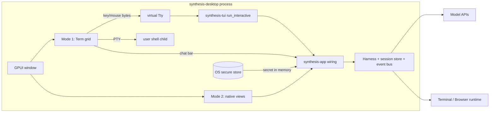

# Spec: Desktop app (Mode 1 TUI, Mode 2 GPUI, onboarding, OS credential store): draft 0.1

Date 2026-10-31. Base: design doc v1.1 §8.2, §10 Phase 4, ADR-008/010/011/014; specs config.md, events.md, tui-design.md §16.
Tags: **[fact: source]** checked in this repo or online on 2026-10-31; **[assumption]** not verified, D0 must probe it; **[OWNER]** needs an owner decision.

## 0. Problem and non-negotiables

The owner wants a standalone desktop app for macOS, Linux and Windows with two modes the user can pick:
- **Mode 1 "TUI"**: the existing TUI renderer (`synthesis-tui-render`, owner design `~/Vibe/synthesis-cli-ui/index.html`) drawn exactly as in a terminal, in a desktop window. A sub-option is a **plain terminal**: a normal shell with a chat input under it, so the user can ask or instruct the agent at any time. The HTML-style agent UI appears only when agent mode is on.
- **Mode 2 "GPUI"**: a native GPUI interface, dark mode first, minimal and refined, with smooth performance.
- **Onboarding**: the user enters base URL and API key in the app instead of editing `synthesis.json` by hand.

Non-negotiables:
1. The core engine stays Rust and UI-independent (ADR-002, ADR-010). The app is a client of the harness and the event bus, like `synthesis-tui` (`crates/synthesis-tui/src/lib.rs:3-7`).
2. Mode 1 is pixel-for-cell the TUI: the same bytes `synth tui` writes. No second renderer of the HTML design.
3. Same config, settings and session files as the CLI (config.md §2). Rust adds no keys to `config.json/v1` (config.md §6).
4. Credentials follow the accepted desktop amendment of ADR-011 (§5). The key is never on disk in plaintext, never in logs, events, argv or settings.
5. Cross-platform CI on all three OSes (CLAUDE.md). Licence compatible with the workspace `Apache-2.0` (`Cargo.toml:9`).

## 1. Engine embedding

| Option | Data flow | For | Against |
|---|---|---|---|
| **E1 In-process crates** (chosen) | app -> shared wiring lib -> `Harness` + `AgentSession` -> typed events on the in-process bus -> UI | One owner of the session lock; approvals answered natively; the key stays in process memory; one binary | A crash in the UI kills running tasks; closing the window ends them |
| E2 Spawn `synth run` / JSONL | app spawns `synth run --prompt`, parses stdout events | Crash isolation; the events.md §6 contract exists | Headless auto-denies every `ask` (events.md §6, README decision 4): no interactive approvals, so chat cannot do real work. Key must be passed in the child env |
| E3 Core daemon + IPC (doc §8.2) | app and CLI talk to a daemon over a local socket | UI close/reopen keeps tasks alive (Phase 4 exit criterion) | Needs a versioned authenticated protocol, durable session ownership (R8), and per-OS endpoint code; nobody has built it yet |

**Decision: E1.** The interfaces already allow it. `synthesis_tui::Options` takes an injected `harness: Arc<Harness>`, `session: AgentSession`, `link: UiLink` and a tokio handle (`crates/synthesis-tui/src/runtime.rs:73-80`), and returns the session on exit (`runtime.rs:50`). **Strongest reason against:** it does not meet the doc §10 Phase 4 exit criterion "UI close/reopen does not cancel daemon-owned tasks". Mitigation: closing a window with a running task asks "Cancel task / Keep window open". The shared wiring lib keeps E3 a transport swap later. **[OWNER] D-1**: accept deferring the daemon (E3) until after R8.

Required refactor: the harness wiring (`prepare`, `Common`, `Prepared` in `apps/cli/src/run.rs`) lives in the bin crate. It moves into a library crate **`crates/synthesis-app`** that both `synth` and the desktop app call. This is behaviour-preserving, and the CLI binary tests (`apps/cli/tests/binary.rs`) stay green.

Event bus: Mode 2 subscribes to the same typed `synthesis-events` stream that `synth run` serialises as JSONL (events.md §1), through `UiLink`/`EventWriter`. No new event types for D0-D3.

## 2. Mode 1 in a desktop window

| Option | How | Verdict |
|---|---|---|
| **T1 GPUI terminal widget over `alacritty_terminal`** (chosen) | `alacritty_terminal::Term` parses VT bytes into a grid; our own GPUI element paints cells and encodes keys and mouse back to bytes | Fidelity comes from a real VT parser; Apache-2.0; Zed uses the same crate |
| T2 `wezterm-term` | Same role | Not published as a normal crates.io library the way `alacritty_terminal` is **[assumption]**; no advantage |
| T3 Webview renders the HTML | Tauri/webview | Rejected: it is a second implementation of the design. The owner requires the TUI renderer, and it puts a JS UI next to a Rust core |
| T4 Paint `synthesis-tui-render` output directly | Interpret the renderer's lines in GPUI without a VT layer | Rejected: the renderer emits SGR strings, so we would rebuild a VT parser anyway |

[fact: crates.io] `alacritty_terminal` 0.26.0, 2026-04-06, Apache-2.0. Its `tty` module provides a Unix PTY and Windows ConPTY **[assumption: verify in D0; Zed's `terminal` crate is built on it]**. No `portable-pty` is needed.
**Licence trap** [fact: zed `crates/terminal/Cargo.toml`]: Zed's `terminal` / `terminal_view` crates are `GPL-3.0-or-later`. We must not copy them. Grid painting, key encoding and mouse reporting are written from the VT/xterm specs.

### 2.1 Agent mode (TUI) source of bytes
- **Chosen: in-process.** `synthesis_tui::run_interactive(options, tty)` runs on its own thread (as its doc comment requires). `Tty` is `{input: Box<dyn Read>, output: Box<dyn Write>, size: Box<dyn Fn>}` (`crates/synthesis-tui/src/tty.rs:11-14`). The desktop builds a `Tty` from two pipes: GPUI key and mouse bytes go into `input`, and `output` feeds `Term`. `size` reads the widget's cell size, and a resize sends the same signal the TUI already handles **[assumption: check how the TUI learns of resizes off a real TTY]**.
- **Fallback if D0 fails** (process-global assumptions in the TUI, such as signals, `process::exit` or stdout prints): spawn the bundled `synth tui --resume <id>` in a PTY. The key then goes to the child as `SYNTHESIS_PROVIDER` + `SYNTHESIS_API_KEY` env, which is weaker (the same OS user can read a process environment). The in-process session must be ended before the child takes the session lock.

### 2.2 Plain terminal with a chat input
```
+--------------------------------------------------------------+
| shell PTY ($SHELL / %ComSpec% or pwsh) painted by Term grid    |
|                                                              |
+--------------------------------------------------------------+
| reply sheet (slides up; agent stream, approvals)  [Esc hide]   |
+--------------------------------------------------------------+
| > ask or instruct Synthesis...   [workspace: ~/proj] [agent ⇄] |
+--------------------------------------------------------------+
```
- The shell is a real PTY child in its own process group, killed as a tree on close (CLAUDE.md cross-platform lessons). Its env is built with `Env::child_env()` (config.md §8), so no `SYNTHESIS_*_API_KEY` reaches it.
- The chat input is a native GPUI input, not part of the grid. Focus moves with `Cmd/Ctrl+L` (the HTML's "focus input" hint) and `Esc` returns focus to the shell.
- Submitting starts a task on the in-process harness (E1), using the same session as agent mode. The reply sheet shows the streamed answer, tool lines and approval prompts. `ask` approvals are interactive there, unlike headless.
- **Workspace = the folder the terminal tab was opened in**, shown in the bar. The agent does not follow the shell's `cd`, because the libraries never infer cwd (README decision 3). Following the shell through OSC 7 is not built.
- `@terminal` in the input attaches the visible screen plus up to 200 scrollback lines, sanitised and wrapped as untrusted data (CLAUDE.md working rules). Nothing is attached without it.
- The **agent toggle** (`Cmd/Ctrl+Shift+A` **[assumption: free in GPUI keymaps]**) swaps the shell grid for the TUI grid (§2.1) on the same session. The shell keeps running in the background, and toggling back restores it.

## 3. GPUI feasibility

| Item | Finding |
|---|---|
| crates.io `gpui` | [fact: crates.io API] 0.2.2, 2025-10-22, Apache-2.0, repo zed-industries/zed. Over a year stale, so not usable as the source |
| Zed upstream | [fact: zed `crates/gpui/Cargo.toml` on main] Apache-2.0, `publish = true`, default features `font-kit, wayland, x11, windows-manifest` (Wayland and X11 both on by default) |
| `gpui-pre` | [fact: crates.io] 0.3.10, 2026-10-26, weekly snapshots of Zed's gpui ("snapshot of zed@08cbb88"), Apache-2.0, published by huacnlee (the gpui-component maintainer), not by Zed Industries |
| `gpui-component` | [fact: crates.io] 0.8.1, 2026-10-26, Apache-2.0, repo longbridge/gpui-kit, "60+ desktop UI components"; depends on `gpui-pre = "=0.3.10"` |
| Platforms | [fact: press] Zed 1.0 shipped on macOS, Linux and Windows (gihyo.jp, 2026-04-29). Windows uses a DirectX 11 renderer and needs a DX11 GPU (Neowin; zed.dev docs). Linux renders with Vulkan **[assumption: still true; Wayland has no current source]** |
| Toolchain | **[assumption]** gpui main needs a newer Rust than the workspace `rust-version = "1.89"`. If so, `apps/desktop` sets its own `rust-version` |
| Accessibility | **[assumption]** GPUI has no screen-reader (AccessKit) integration. This is a real gap for Mode 2 |

**Dependency decision:** use `gpui-component` 0.8.x with its exact `gpui-pre` pin, both pinned `=` and `Cargo.lock` committed. The reason: GPUI core has no ready text input, list, scroll or markdown widgets, and Zed's `editor` is GPL. Writing a text input with IME support from scratch is weeks of work. `gpui-component` and a git-pinned `gpui` cannot be mixed, because they would be two `gpui` type universes. Supply-chain control: on each bump, diff `gpui-pre` against the named Zed commit, and `cargo deny` checks licences.
**Risks:** a single-maintainer republish; weekly breaking changes ("many undocumented breaking changes" is said of related kits); no a11y; Linux GPU-driver variance; build time and binary size.
**Fallback:** if D0 fails a gate, build Mode 2 on **iced** (wgpu, MIT) **[assumption: verify maintenance at that time]**. Mode 1 also needs a host window, so the fallback hosts both modes. The engine side (E1, `synthesis-app`) is unchanged.

## 4. Onboarding (first run, and Settings > Providers later)

Steps, one screen each, all skippable back:
1. **Provider**: Anthropic-compatible or OpenAI-compatible, plus an id (default `anthropic` / `openai`, or a custom id such as `gateway`).
2. **Base URL**: prefilled with the official URL, must be `https://`. `http://` is allowed only for loopback, with a warning.
3. **API key**: a password field, never echoed, and pasting is allowed. Shown afterwards only masked, `sk-p…cdef`, with the same mask as `synth auth status` (`apps/cli/tests/binary.rs:95-103`).
4. **Test connection**: a minimal authenticated call through `synthesis-providers` (list models, or a 1-token request **[assumption: per-protocol endpoint]**). The result is shown only as OK / auth failed / unreachable / TLS error, with the status code. The response body is never shown. Proxy and CA env apply (CLAUDE.md network rules).
5. **Model** (from the test, or typed) and **mode** (TUI / TUI plain terminal / GPUI).

Writes:
- `$SYNTHESIS_HOME/synthesis.json`: `providers.<id>.{type, baseURL}`, `model`, and **no `apiKey`**, using existing `config.json/v1` keys only. The write is a read-modify-write that keeps other keys and `$schema`, goes through a temp file and a rename, and refuses to overwrite a malformed file. That is the pattern of `persist_user_tui` (`crates/synthesis-settings/src/lib.rs:322-355`) and `mcp::edit_file` (`apps/cli/src/mcp.rs:770-803`); lift one shared helper into `synthesis-settings`. The new file is validated by the ported schema before the rename.
- `$SYNTHESIS_HOME/settings.json` -> `synthesis.desktop`: `{mode, plainTerminal, credentials: {"<id>": "os-store"}}`. `credentials` is a **non-secret marker** so the CLI can explain where the key is (§5.5).
- The key goes to the OS store (§5).

Settings > Providers offers **Replace key** (overwrites the store entry), **Delete key** (removes the store entry and the marker, and keeps or removes the provider entry on request), and **Test connection**. Key rotation is Replace followed by Test.

## 5. Credential storage: ADR-011 desktop amendment (ACCEPTED)

**Status: Accepted (owner decision 2026-10-31, relayed by the lead in this design session; to be confirmed in the design doc by the owner).** Options considered before the decision: (a) env var at launch, (b) app-written 0600 file referenced by `{file:}`, (c) OS secure store. The owner chose (c).

### 5.1 Scope (exact)
- **Desktop app only.** The `keyring` crates are dependencies of `apps/desktop` only. CI asserts that `cargo tree -p synth` (the CLI) and every `crates/*` crate contain no `keyring*` crate.
- The headless CLI, the core and every library crate keep ADR-011 unchanged: env / `{env:}` / `{file:}`; they never write credentials and never read the OS store.
- The app is the only writer of the store entry (`service = "Synthesis"`, `account = <provider id>`). It writes only on the user's explicit Save, Replace or Delete.
- The app reads the secret when an engine is built and hands it over **in memory**: a new lowest-priority credential source in `synthesis-config` credential resolution (config.md §5: env > provider config > store). That slot is the legacy `auth.json` slot; the app supplies `HashMap<ProviderId, Secret>`, and the CLI passes none. An explicit `SYNTHESIS_API_KEY` or a config `apiKey` therefore still wins. **The app never sets the process env.** Only in the §2.1 fallback does it pass `SYNTHESIS_PROVIDER` + `SYNTHESIS_API_KEY` to the `synth` child env.
- The key never goes to disk (no cache file and no plaintext Linux fallback written by the app), argv, logs, events, crash reports, settings or clipboard.

### 5.2 Crate choice
[fact: crates.io] `keyring` 4.2.0 (2026-08-29, MIT OR Apache-2.0, open-source-cooperative/keyring-rs, frequent releases). v4 split the stores into separate crates behind `keyring-core` ^1.
Use **`keyring-core` + `apple-native-keyring-store` (macOS) + `windows-native-keyring-store` (Windows Credential Manager) + `zbus-secret-service-keyring-store` (Linux Secret Service; pure-Rust D-Bus with `crypto-rust`, so no libdbus at build time)**, each gated with `cfg(target_os)`. Not used: `linux-keyutils-keyring-store` (the kernel keyring does not survive a reboot) and `db-keystore` (an on-disk store). Exact v1 store API names are **[assumption: D0]**.

### 5.3 Linux without a Secret Service
This covers no gnome-keyring or KWallet, or a locked collection the user will not unlock. **Recommendation: env-only, and the app writes nothing.** Onboarding detects that the store is missing and shows two choices: launch with `SYNTHESIS_API_KEY` set, or create your own 0600 file and set `apiKey: "{file:~/.config/synthesis-key}"`. The app then writes only the `{file:}` reference to `synthesis.json`, never the file itself. It also checks the file mode before use and warns if the file is group- or world-readable **[assumption: config does not already check this]**. **[OWNER] D-2**: confirm env-only, or let the app write the 0600 file after an explicit "I accept plaintext on disk" checkbox.

### 5.4 Security trade-offs (honest)
- What the store protects: encryption at rest, the key stays out of dotfiles, backups and accidental git commits, and macOS binds Keychain ACLs to the code signature.
- What it does not protect against: same-user malware. Windows Credential Manager generic credentials are readable by any process of the same user. An unlocked Secret Service collection is readable by any D-Bus client of the session. This is the same threat model as ADR-012's same-user boundary.
- macOS: unsigned or rebuilt dev binaries trigger a Keychain prompt on every new signature. Developer ID signing is needed for a usable release (D4).
- Redaction:
  - The secret sits in a newtype whose `Debug`/`Display` print `‹redacted›`. It is dropped right after the provider client is built **[assumption: the provider client must keep a copy for headers]**.
  - The existing event redaction (events.md §5) and the `child_env()` allowlist (config.md §8) stay the outer layers.
  - Error texts from the store backends are mapped to fixed messages before display.

### 5.5 Headless compatibility
A user who onboarded only in the app and then runs `synth` in a shell gets "no credential". `synth auth status` and `synth doctor` read the non-secret marker `synthesis.desktop.credentials` and print: "key for `<id>` is in the desktop app's OS store; the CLI does not read it; set SYNTHESIS_API_KEY or use {file:}". They never touch the store, so they cause no Keychain prompts. Letting the CLI read the store would be a further amendment, which is not proposed.

### 5.6 Proposed wording edits (the lead/owner applies them; not applied here)
- **Design doc ADR-011 row:** append "**Amended 2026-10-31 (desktop):** the desktop app (`apps/desktop`) may store an API key the user enters during onboarding in the OS secure store (macOS Keychain, Windows Credential Manager, Linux Secret Service). It is the only writer, writing on explicit user action, and it hands the key to the engine in memory as the lowest-priority credential source. The CLI, core and library crates still never read or write a keychain and never write credentials. No plaintext fallback is written by the app (docs/specs/desktop.md §5)."
- **Design doc ADR table:** add ADR-015 "Desktop app embeds the engine in-process (E1); Mode 1 renders TUI bytes through `alacritty_terminal`; Mode 2 uses GPUI via `gpui-component`/`gpui-pre` pins; daemon deferred".
- **config.md §8 rule 3:** change it to "No OS keychain, no credential store written by Rust, **except the desktop app (desktop.md §5)**…", and add the in-memory source to the §5 resolution order.
- **CLAUDE.md, "API keys only (ADR-011)" bullet:** replace "no keychain, and Rust never writes credentials" with "no keychain and no credential writes in the CLI, core or library crates; the desktop app alone may store the user's key in the OS secure store and pass it to the engine in memory (ADR-011 desktop amendment, docs/specs/desktop.md §5)".
- **specs/README.md open question 3:** add "amended for the desktop app 2026-10-31".

## 6. Layout

```
apps/desktop/            bin `synthesis-desktop` (app bundle name "Synthesis"); GPUI shell, onboarding,
  src/main.rs              mode switch, keychain (only crate depending on keyring-*)
  src/onboarding.rs
  src/credentials.rs       OS store wrapper + Secret newtype
  src/term/                Term grid element, key/mouse encoder, PTY (alacritty_terminal)
  src/mode1.rs             plain terminal + chat bar + agent toggle (virtual Tty)
  src/mode2/               GPUI UI: sessions, conversation, diff, approvals, timeline
crates/synthesis-app/    harness wiring lifted from apps/cli/src/run.rs (used by synth and desktop)
```
- The terminal widget stays a module, not a crate, until a second user exists.
- `apps/desktop` is excluded from the workspace `default-members`, so `cargo test --workspace` CI for the core does not need GPUI system libraries. A dedicated desktop CI job builds it on all three OSes.
- `unsafe_code = "forbid"` is inherited; GPUI's own unsafe lives in dependencies.
- Settings: `synthesis.desktop.*` in user `settings.json` only. Project settings can never set it (same rule as `synthesis.tui.theme`).



## 7. Phases and acceptance criteria

| Phase | Deliverable | Accept when (evidence on macOS, Linux, Windows CI unless marked) |
|---|---|---|
| **D0 spike** (timebox 1 week) | Hello window with `gpui-component` pins; a Term grid rendering `synth tui --once` bytes; the virtual-Tty `run_interactive` against a fake provider; keyring round-trip | Builds on 3 OSes with the documented Linux system packages. The rendered grid text equals `synthesis_tui::replay()` of the same bytes for 3 goldens. A keyring set/get/delete test passes on macOS and Windows, and on Linux under `dbus-run-session` + gnome-keyring. Every §3 and §5 [assumption] is resolved or listed as a blocker. Go/no-go for GPUI is recorded here |
| **D1 onboarding + shell** | `synthesis-app` refactor; window, mode picker, onboarding, Settings > Providers | CLI tests unchanged and green. Onboarding writes a schema-valid `synthesis.json` without `apiKey`. A sentinel-key test finds the key in no file under `$SYNTHESIS_HOME`, no event, no log and no child argv/env. Test connection with a fake server returns OK and auth-failed. The Linux no-Secret-Service path shows the env-only guidance |
| **D2 Mode 1** | Plain terminal + chat bar + reply sheet + agent toggle; the TUI through the virtual Tty | `vim`, `htop`/`top`, `git log` paging and resizing work in the shell (ConPTY on Windows). An approval in the chat bar allows and denies correctly. Toggling agent mode shows the same session with its transcript. All TUI render goldens replayed through the widget match cell for cell. Killing the window kills the shell tree |
| **D3 Mode 2 dark** | Sessions list, conversation stream, tool cards, diff + approval, event timeline, command palette | Budgets in §8 met on the reference machines. Every event type in events.md §3 has a view or a deliberate "not shown". Owner review of screenshots against §8 |
| **D4 packaging/CI** | `cargo-packager` bundles; signing; release job | [fact: crates.io] `cargo-packager` 0.11.8 (2025-11-27, MIT/Apache) builds `.app`/`.dmg`, `.deb`/AppImage and NSIS/MSI **[assumption: formats]**. The macOS build is Developer-ID signed and notarised, and Windows is Authenticode-signed **[OWNER: certificates]**. A clean-VM install, onboarding and one task run on each OS, as a recorded manual run |

## 8. GPUI look: principles and budgets (Mode 2)

- **Design source (owner, 2026-10-31):** Mode 2 follows `design/03-designs/desktop/desktop.html` and `desktop-preview.png` (read the markup, same rule as the TUI). It supersedes the palette guesses below where they differ. Structure from the design: custom titlebar with traffic lights, project/session title and `⌘K`; left sidebar (brand mark, Workspace, Sessions, Topology, Code & Diff, Browser, Terminal, Verification, Approvals, Settings, active project with branch and worktree); a workspace header (title, runtime line, Pause, View Diff, New Task); a three-column grid: chat session (user message, answer, task progress with ✓/◉/○, inspectable-actions strip, composer) spanning two rows, agent topology (eight capability cards around a "Synthesis Core" card joined by curved links), Activity & Events trace, Terminal/Browser/Diff tabs, Verification & Evidence checklist. The PNG shows the landing state: greeting "What shall we build today?", large composer with Codebase/Image/Document chips, Auto mode, send, and four suggestion cards; plus Sessions list with tags, Activity feed, Code & Terminal.
- **v2 proposal (2026-10-31, pending owner review):** `design/03-designs/desktop/desktop-v2.html` replaces the nine-item sidebar of v1. Sidebar = New task, search, Projects with their sessions (status dot: running / needs you / done), then Settings, provider status, and the TUI | Native interface switch. All former nav items (Topology, Diff, Browser, Terminal, Verification, Memory, Files) become tabs of a collapsible right inspector; approvals appear inline in the conversation (and as a `needs you` dot); everything else is reachable through `Cmd/Ctrl+K`. If v2 is accepted it supersedes the v1 structure above; the palette and component style stay.
- **Agent Topology (owner decision, 2026-10-31):** the desktop Topology panel does NOT use the eight-card capability graph of desktop.html. It reproduces the topology of the owner's TUI HTML (`~/Vibe/synthesis-cli-ui/index.html`: `STATE.topology1`, `renderTopology`, and `topology2`/`renderTopology2` for the core graph; read the markup) with the same content, nesting, colours-by-group and links, but drawn with the desktop component style (panel gradient, 1 px hairline, radius 11-16, desktop tokens, GPUI-drawn curved links).
- **Tokens (from the desktop.html `:root`):** bg `#0B0D10`, surface `#14171C`, panel `#181C22`, line `#2B3038`, muted `#9096A0`, text `#EEF0F2`, silver `#C6C9CE`, pearl `#F0E9E3`, accent `#C7BDB6`; success `#A0BDAA`, pending `#D5C2AD`, error-dot `#B65E60`. Panels use a 1 px hairline, radius 11-16 and a very subtle diagonal gradient; the Core card has a warm pearl border and faint glow. Colour means status only. A light theme comes later with the same semantic token names (ADR-014 style).
- **Typography:** system UI font for chrome and the system monospace for code and terminal. **Owner decision (2026-10-31, D-3 closed):** Settings > Appearance lets the user pick the font from a few bundled fonts (OFL: JetBrains Mono, Fira Code, plus 1-2 more chosen in D3, e.g. IBM Plex Mono) or the system font; the DEFAULT is a monospace font for code, terminal and chat. Fonts are subset/embedded in the app only (not in `synth`); the choice is stored in user settings (`synthesis.desktop.font`) and applies live. Scale 11 / 12 / 13 (base) / 15 / 20 px; line height 1.45 for prose and 1.3 for code; weights 400 / 500 / 600 only.
- **Space and shape:** a 4 px grid; padding 8 / 12 / 16 / 24; radius 6 for controls and 8 for panels (the HTML uses 8); 1 px hairline borders at low contrast; no drop shadows except on overlays. Density follows the HTML: information-rich but quiet.
- **Motion:** 120-180 ms ease-out for panel and sheet transitions; no animation of streaming text (only the caret and one subtle activity indicator); honour the OS reduce-motion setting.
- **Interaction:** keyboard first (command palette `Cmd/Ctrl+K`, every action has a binding); visible focus ring; text contrast at least 4.5:1; approvals are never default-focused on Allow.
- **Performance budgets** (reference: M1 MacBook Air, mid-range Windows laptop with iGPU, Linux iGPU under Wayland):

| Metric | Budget |
|---|---|
| Cold start to first interactive frame | ≤ 500 ms |
| Keystroke to paint, p95 | ≤ 16 ms |
| Frame time while streaming or scrolling | ≤ 8 ms (120 Hz), no dropped frames over a 10k-item transcript (virtualised lists) |
| Idle CPU, window open, no task | ≈ 0 %, no timers except the clock |
| Memory, idle with one session | ≤ 250 MB **[assumption: realistic for GPUI + fonts]** |
| Terminal throughput | `cat` of a 100 MB file without UI stall; PTY reads batched and redraws coalesced to vsync |

Measure with a `--bench-frames` debug flag that logs frame times to a JSONL file. CI tracks start time and memory only; frame timing is checked manually on the reference machines.

## 9. Test strategy

- **Engine:** existing crate tests; `synthesis-app` gets the CLI's binary tests as its regression net.
- **Fidelity:** Term-grid snapshot equals `replay()` for every TUI golden (the strongest Mode 1 test, headless, 3 OSes).
- **Terminal I/O:**
  - Key and mouse encoder unit tests against xterm sequences.
  - PTY integration tests (spawn `echo`, resize, kill tree) on 3 OSes.
  - ConPTY and Git Bash quoting verified on a real Windows machine (CLAUDE.md "unverified until run").
- **UI:** GPUI headless test context for view-state logic **[assumption: `gpui::TestAppContext` available in `gpui-pre`]**; no pixel tests in CI; owner screenshot review per phase.
- **Credentials:**
  - Unit tests with an in-memory mock store.
  - Real-store tests in CI as listed in D0.
  - Sentinel-key leak test (D1).
  - `cargo tree` guard that no `keyring*` crate enters `synth` or the library crates.
- **Ops:**
  - Logs go to `$SYNTHESIS_HOME/logs/desktop-*.log` (rotated, redacted, no event payload bodies).
  - `synth doctor` gains a desktop section (marker present, store reachable: yes/no, without reading the secret).
  - Crash-safe: a panic in the UI thread ends tasks through cancellation tokens. The session store is already crash-tolerant (session-store.md).

## 10. Open owner decisions

1. **D-1** Defer the daemon (E3) and accept that closing the window cancels running tasks, after a confirmation. This deviates from the doc §10 Phase 4 exit criterion until after R8.
2. **D-2** Linux without a Secret Service: env / user-made `{file:}` only (recommended), or let the app write a 0600 plaintext file behind an explicit opt-in.
3. **D-3** CLOSED by owner: user-selectable bundled fonts, mono default.
4. **D-4** GPUI source: accept `gpui-component` + `gpui-pre` (third-party snapshots of Zed's Apache-2.0 gpui) as the pinned dependency, with iced as the fallback if D0 fails.
5. **D-5** Signing certificates (Apple Developer ID, Windows Authenticode) and who holds them (D4).
6. **D-6** Confirm the ADR-011 desktop amendment wording in §5.6, and whether this record of the relayed decision is enough or the owner signs it in the design doc.

## Follow-ups for the planner
- Move `prepare`/`Common`/`Prepared` from `apps/cli/src/run.rs` into `crates/synthesis-app` (behaviour-preserving, D1 first step).
- Add the in-memory lowest-priority credential source to `synthesis-config` resolution, with a test that env and config still win.
- Lift a shared atomic "edit user JSON" helper into `synthesis-settings` (replaces the duplicates in `persist_user_tui` and `mcp::edit_file` only when touched).
- `synth auth status` / `synth doctor`: read the `synthesis.desktop.credentials` marker (§5.5).
- Add `apps/desktop` to the CI matrix as a separate job, document the Linux build packages, and add the `cargo tree` keyring guard.
- Apply the §5.6 wording edits after owner confirmation, and update specs/README.md with this spec's row.
